# Shared file index completion — multi-agent implementation plan

Date: 2026-10-08. Tree: `7c68786` plus the uncommitted working tree as of this date.
Inputs: `indexing.md`, `TemplarOS-indexing-completion-plan-2026-10-08.md` and
`TemplarOS-indexing-source-audit-2026-10-08.md` in this directory. The audit's E-numbers are
used throughout. Goose (`https://github.com/aardappel/goose`, read at `35368105e3d5`) is a
**design reference only**. No Goose compiler, runtime, generated C or FFI enters any TemplarOS
build.

This plan replaces the detailed Phases B–F of `docs/planning/integrated-indexing.md` §2 where
they overlap. Phase D (FSearch) and Phase E (Silvaview) are refined here as WP14 and WP15.

## Owner amendment — 2026-10-09

The first-party PixelKit Apps/Files launcher is the selected discovery surface. Files mode uses
Index1 directly; Search Here scopes that same popup explicitly. FSearch routing, inferred provider
default and fork/package adoption are retired. The WP14 prototype and its retained measurements
remain historical; the old FSearch shipping requirements below are superseded by the unified
launcher work. Index1 compatibility, native paths, paging and consumer freshness remain required.

## Owner amendment — 2026-10-08

The owner deferred WP14's same-query generation comparison with the shell's
former native Files search notice. That ordinary route has been retired. The
selected future direction is an integrated Index1 search GUI with a large
FSearch-style window. This amendment records the direction; it does not claim
that the GUI has been implemented or accepted.

The working FSearch Index1 fork, native package and private GTK evidence remain
qualified prototype results. WP14's comparison stays explicitly deferred, and
WP16's fork shipping/default adoption is deferred pending the integrated consumer
work. PCManFM Find remains separate. Continue the independent index, Silvaview,
crash and closure work; installed consumer qualification must name the actual
consumer available at that time.

---

## 0. How to use this plan

- One **integration owner** (the parent session) runs WP0, freezes §3, assigns work packages
  (WP) to agents wave by wave (§4), runs every build and test, and closes the ledger.
- Each WP is self-contained: the files it owns, what it depends on, exact changes, the tests
  it adds, its acceptance criteria, and what it must not do. Agents implement exactly that.
  If an agent finds that a stated fact is false in the tree, it stops and reports; it does not
  redesign.
- Every spawned agent's brief must begin with: `You are a subagent. Don't run memo.`
  Agents **do not build, test, lint or format** (AGENTS.md). The integration owner does, and
  returns failures to the owning WP.
- Hard rules for everyone, from AGENTS.md:
  - Never touch the live session. No `systemctl --user` on `templar-*` units, no
    `pkill`/`killall` by a name that matches an installed `templar-*` binary, no
    `templar dev deploy`, and no service on the live user bus.
  - Runtime proofs use `scripts/test-nonzero.sh` (a private bus and a scratch HOME),
    `services/templar-filed/tests/private_runtime.rs`, the xtask private daemon, or
    `scripts/nested-session.sh`.
  - Never edit `docs/generated/`. Never read `.akr/cache/`.
- Builds: `CARGO_TARGET_DIR` comes from `scripts/native-target-dir.sh` (the justfile exports
  it). Use `CARGO_INCREMENTAL=0`. Run one heavy build at a time; the 2026-10-07 OOM is on
  record.

---

## 1. Verified baseline (WP0 starting tree, not the Oct 7 pack)

Two read-only scouts re-checked every audit finding against the current tree on 2026-10-08.
The table records the starting tree before the fixes; its line numbers and
"present" labels are historical. Current qualification is recorded in the
[continuation](continuation-2026-10-08.md) and
[acceptance audit](../measurements/index-qualification-audit-2026-10-08.md).

| ID | Finding | Current location | Status |
|---|---|---|---|
| E02 | Arrays are used only when the **global** generation matches exactly. Rebuilds are spaced at least `max(5 s, 2 × last build)` apart. | `arrays.rs:108,112-124,128-144`; `query.rs:688-740` | present |
| E03 | `scope()` sorts the `within` intervals without merging them, so `in_scope` gives the wrong answer for nested intervals. `add_root` has no overlap rule. `build` assumes disjoint roots ordered by path. | `arrays.rs:443-469,591-597,175-177`; `lib.rs:429` | present |
| E04 | The snapshot payload is a whole `Vec`. `SnapshotReader::entries()` returns a `Vec`. The client reads the whole fd into a `Vec` (512 MiB bound). | `snapshot.rs:195,618`; `tree_source.rs:80,173-186` | present |
| E05 | `Search`, `FetchPage`, `OpenSnapshot` and `ChangesSince` run synchronous core calls inside async handlers. `with_read` caps only idle readers. Each query spawns up to 8 match threads. `Search1.search` is also synchronous. | `index_host.rs:300-366`; `lib.rs:338-359`; `arrays.rs:495-510`; `dbus.rs:900` | present |
| E06 | `root_returned` and `set_volume_identity` have no callers. Identity is `st_dev` only, and a missing identity counts as "same volume". Nothing reads mountinfo or uses UDisks. | `reconcile.rs:477-499`; `lib.rs:565`; `watch.rs:690-701`; `watcher.rs:295-299` | present |
| E07 | Any `open_migrated` error leads to `move_aside`, which **deletes** the database if the rename fails and always deletes `-wal`/`-shm`. | `lib.rs:243-256,292-302` | present |
| E08 | Cursors expire only on `insert`/`get`. `oldest_generation` does not expire first and feeds tombstone pruning. Cursors have no owner. The shell reads only its first page (`page_size: 50`) and never handles `SnapshotRequired`. | `query.rs:277-344`; `generation.rs:396`; `shell/.../app.rs:6850-6922` | present |
| E09 | There is no FSearch source, fork or packaging. `../Silvaview-rs` has no Index1 code. | `providers.rs:164`; `distro/forks/manifest.toml` | open |
| E10 | `db_bytes` counts only the main file. Doctor and Settings show no runtime budgets. | `lib.rs:195,752`; `cli/templar/src/doctor/checks.rs:1479-1640` | present |

The audit did not report these. Agents must treat them as facts:

- **N1: a scan can publish a lower generation than the published head.**
  - `begin_scan` takes its generation G when the scan starts (`generation.rs:671`).
  - The commit raises `index_meta.committed_generation` only if `G > head` (`generation.rs:575-584`).
  - Meanwhile the merged rows carry `written_generation = G`.
  - If a mutation publishes H > G while the scan runs:
    - Arrays built at H still pass `current_for(H)` but lack the scan's rows.
    - `fetch_page`'s `written_generation > cursor.generation` fence (`query.rs:788`) misses those rows.
  - Consequence: stale answers labelled current. Fixed by WP1.
- **N2: entry ids can be reused.** `entries.entry_id` is `INTEGER PRIMARY KEY` without
  `AUTOINCREMENT` (`schema.rs:69-70`), so SQLite can reissue an id after the maximum row is
  pruned. This is the stale-slot hazard of Goose sample 26. Any structure keyed by `EntryId`
  across generations must also compare `written_generation` (WP11, WP12).
- **N3: `forget_root` does not advance the generation.** It runs three un-transacted DELETEs
  (`lib.rs:470-479`), so arrays at the same generation can still return that root's rows.
  Fixed by WP1.
- **N4: shell search rendering is O(n) per frame.** Each frame `draw_entries` allocates a heights
  `Vec` and clones every path (`file_browser.rs:1514-1517`). This must change before
  pages can hold up to 100k rows (WP10).
- **N5: there is no SQL cancellation anywhere.** There is no `interrupt` or `progress_handler`
  use. The rusqlite `hooks` feature is not enabled. `get_interrupt_handle` needs no feature.

What is already done, and must be preserved rather than redone (E01):
- indexed immediate children and migration 6;
- authoritative root policies and the cache UUID (migration 7);
- monotonic root ids;
- observation tokens without renewal polling;
- store-free client models;
- native-path actions;
- split namespace/metadata freshness;
- generation/change-sequence lineage;
- kernel-sealed read-only snapshots;
- cursor fences;
- Btrfs pre/post baselines and fences;
- shell search over `SearchSession`;
- the Settings Files page (`apps/templar-settings/src/files.rs`);
- the CLI `files index` commands.

---

## 2. Settled decisions (agents do not reopen these)

| # | Decision | Reason |
|---|---|---|
| D1 | SQLite stays the durable store and the correctness reference. inotify stays the event backend. The Btrfs catch-up stays optional. Everything is written in Rust. Goose ideas are transplanted into Rust data layouts only. | Goose limits: compiled exports are single-threaded, `list_dir` drops non-UTF-8 and newline names, stack exhaustion aborts, and the toolchain is young. Its benchmark wins over Rust are near 1.0× for tree, graph, LRU and string-list workloads. |
| D2 | **Generation publication invariant.** Every commit that changes visible rows publishes a head **strictly greater** than every earlier head. Every row it writes carries `written_generation ==` that head. Root removal is such a commit. | Fixes N1 and N3. Root-local array validity (WP11) depends on it. |
| D3 | **Most-specific root ownership happens at acquisition.** Nested root registrations are allowed. A containing root's scan, watch and reconcile treat every nested registered root path as a boundary (an implicit skip). Content is therefore disjoint. Projects are logical `Query.within` scopes, not roots. | It matches `tree_source.rs` most-specific decoding. It allows a different policy per subtree and a nested mount with its own root. Existing overlaps converge at the next reconcile, which tombstones the duplicate rows; nothing is silently rejected. |
| D4 | Array scope is a **normalized disjoint union** of intervals: sorted, then merged when overlapping or adjacent. | Fixes E03. Membership becomes a single binary search. |
| D5 | Cache open failures are **classified** before any recovery. Only proven corruption or an incompatible format leads to quarantine, which moves the database and its sidecars together. Nothing is deleted in place. An exclusive owner lock is required before recovery. Operational failures leave filed running with Index1 `Unavailable`. | Fixes E07. The cache is derived, but destroying it under disk-full or busy conditions is wrong. |
| D6 | **Execution lanes in filed**: Interactive, Bulk and Maintenance, each a fixed set of std worker threads behind a bounded queue, with per-caller limits. The reader pool is a hard cap. Typing gets latest-request-wins cancellation through SQLite interrupt plus cooperative checks. Admission happens before any work starts. | Fixes E05. Tokio's `spawn_blocking` cannot abort started work. A fixed thread count gives a fixed CPU and memory bound. |
| D7 | Snapshot wire FORMAT 1/2 stays **byte-identical**. The writer streams to a seekable sink and patches the header at the end. The reader becomes a borrowed iterator. Clients map the sealed memfd read-only after verifying its seals. The service enforces quotas. Storage views load summary-first. | Fixes E04 without breaking existing consumers or tests. |
| D8 | A cursor is **owned by the caller's unique bus name**. It is released on disconnect. Expiry runs before every retention read. Each owner has its own cap, so one client cannot evict another's cursors. Another owner's cursor answers as "unknown cursor" (`SnapshotRequired`). | Fixes E08 (core). It does not leak cursor existence. |
| D9 | **Volume presence comes from `/proc/self/mountinfo`** via `poll(POLLPRI)`, which is event-driven with no timer. UDisks only enriches identity (IdUUID/IdLabel/removable). Identity has a confidence level. No root is ever scanned while its volume is absent. A different volume at a root's path is a **user decision**, never an automatic purge. | Fixes E06. Implements the inotify mount blind-spot rule (U2) and the UUID-may-be-absent rule (U4). |
| D10 | Acceleration comes in stages. First, **per-root immutable shards** that are valid per root generation (WP11). Second, a bounded delta overlay, **only if WP6/WP11 measurements justify it** (WP12). If they do not, a decision record says why. Path needles stay on SQL. There is no new database, no GPU and no new watch backend. | E02. Measure before adding mechanism. |
| D11 | FSearch gets a **C remote facade** behind a meson option, implementing the existing `fsearch_database.h` API over GDBus and json-glib. In that build, scanning, monitors and `fsearch.db` are compiled out. | The existing Phase D recommendation. The facade keeps upstream UI, sort and selection contracts and minimizes rebase surface. |
| D12 | Silvaview gets `--index=auto|service|scan`. Service mode links `templar-file-index` with `default-features = false` (the store-free reader) plus zbus, behind a `templaros` cargo feature on Linux only. | E09. Keeps Silvaview's AGPL repository independent of the SQLite store. |
| D13 | Diagnostics extend the existing `Diagnostics` struct and `Index1.Roots` JSON. There is no second state database. Doctor and Settings render them. | E10. |
| D14 | The distro-wide recommendations (indexing.md §9; completion-plan "Broader distro") are **not** planned here. They map to existing ledger heads (Appendix B). | Scope. |

---

## 3. Contract freeze (WP0 publishes this; later WPs implement it)

Every D-Bus change is **additive**: new JSON fields with serde defaults, new error names, and
one new method. Existing signatures do not change, so there is no Index2.
`check-interface-signatures` reports a new member as "new" and passes it. After the method is
added, run `cargo run -q -p xtask -- interface-baseline`.

### 3.1 Index1 JSON additions (`templar-file-index` model/query/snapshot types)

| Type | New field | Semantics | Owner WP |
|---|---|---|---|
| `Query` | `client_tag: Option<String>` (≤ 64 bytes) | Latest-request-wins key, scoped to the caller's unique name. A new Search with the same `(caller, tag)` cancels the earlier in-flight one. | WP7 |
| `SearchResult` (and the client `IndexSearch`) | `total_files: Option<u64>`, `total_folders: Option<u64>` | Per-kind split of `total`. `None` when the planner did not count. Arrays count both for free; SQL adds `SUM(kind=1)` to the existing count. | WP7 (core), WP14 consumer |
| `SearchResult` | `strategy: String` (`"arrays"`, `"arrays+overlay"`, `"sql"`), `queue_ms: u32` | Diagnostics only; never used for decisions. | WP7, WP11 |
| `SnapshotRequest` | `max_depth: Option<u32>`, `max_entries: Option<u64>` | Depth is relative to `subtree`, or to the root. A request exceeding `max_entries` fails with `TooLarge` before the frame is sealed. | WP8 |
| `Diagnostics` (`Roots` JSON) | `availability: {state: "available"\|"unavailable", reason, since_ms}`, `storage: {main_bytes, wal_bytes, shm_bytes}`, `runtime: RuntimeDiagnostics` (§WP13) | Additive. Doctor's read-only path fills `storage` but leaves `runtime` absent. | WP4 (availability, storage), WP13 (runtime) |
| `VolumeIdentity` | `fs_type`, `fs_uuid` (from `/dev/disk/by-uuid` or UDisks), `fsid` (statfs), `mount_root` (mountinfo field 4), `mount_id`, `confidence: "strong"\|"weak"\|"none"` | `strong` = fs_uuid + mount_root. `weak` = dev/fsid only. | WP9 |
| `RootStatus` | `offline_reason: Option<OfflineReason>` (`volume-absent`, `different-volume{observed}`, `unmounted`) | Says why a root is offline and what action is available. | WP9 |
| `StaleReason` | `VolumeReturned`, `VolumeReturnedUnverified` | New variants. | WP9 |

### 3.2 New D-Bus error names (`IndexError::dbus_name`, `error.rs:107`)

| Name | Raised when | Client behaviour |
|---|---|---|
| `org.templaros.Files.Index1.Error.Busy` | Lane queue or per-caller limit full; reader pool wait > 5 s | Interactive: retry once after 50 ms, then show "busy". Bulk: show it. |
| `org.templaros.Files.Index1.Error.Cancelled` | Superseded by the same `client_tag`, or caller vanished | Silently drop. |
| `org.templaros.Files.Index1.Error.TooLarge` | Snapshot quota exceeded | Fall back to summary/subtree; never to a scan. |
| `org.templaros.Files.Index1.Error.Unavailable` | Index cache unavailable (D5) | Show the reason; offer Retry (Settings). |
| (existing) `...Error.SnapshotRequired` | unchanged | Re-run the query (WP10). |

### 3.3 New method

`AcceptVolume(x root_id, s observed_fingerprint) -> ()`. It is fenced: it succeeds only when
`observed_fingerprint` equals the root's currently observed `different-volume` identity
fingerprint (sha256 of the canonical identity JSON). It forgets the cached rows of the previous
volume for that root and queues a full scan. Settings is the only caller. It goes in XML, the
server, the client trait (`proxies/files.rs`) and the baseline.

### 3.4 Core (Rust) API changes: clean cutover, every caller migrated

```rust
// crates/templar-file-index/src/context.rs (new, store feature)
pub struct CallContext {
    pub owner: Option<Arc<str>>,                 // unique bus name; None = in-process/internal
    pub cancel: CancelToken,                     // generation.rs:36, reused
    pub deadline: Option<std::time::Instant>,
    interrupt: Mutex<Option<rusqlite::InterruptHandle>>, // set by with_read while body runs
}
impl CallContext {
    pub fn internal() -> Self;                   // tests, xtask, maintenance
    pub fn cancel(&self);                        // sets token AND interrupts the live statement
    pub fn check(&self) -> Result<()>;           // Err(Cancelled) on token or deadline
}

// Index (query.rs / snapshot.rs / mutation.rs): signatures change
pub fn search(&self, query: &Query, cx: &CallContext) -> Result<SearchResult>;
pub fn fetch_page(&self, cursor: &str, offset: u32, count: u32, cx: &CallContext) -> Result<Page>;
pub fn close_cursor(&self, cursor: &str, cx: &CallContext);
pub fn release_owner(&self, owner: &str);        // drops all cursors of a departed caller
pub fn write_snapshot<W: Write + Seek>(&self, sink: &mut W, req: &SnapshotRequest,
                                       limits: &SnapshotLimits, cx: &CallContext)
    -> Result<SnapshotManifest>;
pub fn changes_since(&self, seq: u64, limit: u32, cx: &CallContext) -> Result<ChangesBatch>;
```

`SQLITE_INTERRUPT` maps to `IndexError::Cancelled`. New `IndexError` variants:
- `Busy { what: &'static str }`
- `TooLarge { entries: u64, bytes: u64 }`
- `Unavailable { reason: OpenFailure }`
- `Incompatible { found: String, supported: String }`

`Incompatible` replaces the format and migration-count cases of `Corrupt` in `schema::migrate`.

---

## 4. Execution waves and ownership

```mermaid
flowchart LR
  WP0[WP0 baseline + freeze] --> W1
  subgraph W1[Wave 1 — parallel]
    WP1[WP1 generation invariant]
    WP2[WP2 scope + parity]
    WP3[WP3 nested-root ownership]
    WP4[WP4 cache recovery]
    WP5[WP5 cursor ownership]
    WP6[WP6 measurement harness]
    WP9[WP9 volume lifecycle]
  end
  W1 --> W2
  subgraph W2[Wave 2 — parallel]
    WP7[WP7 lanes + cancellation]
    WP8[WP8 streaming snapshots]
    WP10[WP10 client errors + shell paging]
    WP14[WP14 FSearch facade]
  end
  W2 --> W3
  subgraph W3[Wave 3 — parallel]
    WP11[WP11 root shards + compact layout]
    WP13[WP13 diagnostics + WAL]
    WP15[WP15 Silvaview service]
  end
  W3 --> WP12[WP12 delta overlay — gated]
  W3 --> WP16[WP16 provider switch]
  WP12 --> WP17[WP17 qualification + closure]
  WP16 --> WP17
```



The integration owner gates each wave:
1. `cargo check --workspace --all-targets`
2. `scripts/test-nonzero.sh -p templar-file-index -p templar-filed -p templar-client -p templar-treemap`
3. `cargo clippy` on the touched crates with `-D warnings`
4. `cargo fmt --all -- --check`
5. `just check-interfaces` once §3 members exist
6. Shell/Settings renders where touched

Failures go back to the owning WP agent. A wave closes only when it is green.

### 4.1 Region ownership (agents share one working tree)

When two WPs touch one file, each owns only the named functions. No agent reformats, renames
or moves code outside its regions.

| File | WP1 | WP2 | WP3 | WP4 | WP5 | WP7 | WP8 | WP9 | WP10 | WP11 | WP12 | WP13 |
|---|---|---|---|---|---|---|---|---|---|---|---|---|
| `file-index/src/arrays.rs` | | `scope`, `in_scope`, `build` ordering | | | | `match_ranks` (threads param, scratch, cancel) | | | | whole file | overlay hooks | |
| `file-index/src/query.rs` | | | | | `Cursor`, `CursorStore`, `fetch_page`, `close_cursor` | `search`/`run_search` ctx, per-kind totals | | | | `search_arrays`, `request_arrays` | merge | |
| `file-index/src/lib.rs` | `forget_root` | | `add_root` doc + nested lookup | `open`, `open_migrated`, `move_aside`, `Diagnostics` storage | | `with_read`, `IndexConfig` | | `set_volume_identity`, `mark_*` | | | | `diagnostics` runtime |
| `file-index/src/generation.rs` | commit publish | | `begin_scan` skip list | | `:396` call only | | | | | | | |
| `file-index/src/mutation.rs` | `apply_transaction` publish | | | | | `changes_since` ctx | | | | | | |
| `file-index/src/scan.rs`, `watch.rs` | | | boundary skip | | | | | `watch.rs:690-701` offline | | | | |
| `file-index/src/snapshot.rs` | | | | | | | whole file | | | | | |
| `file-index/src/{schema,model,reconcile}.rs` | | | | `schema::migrate` errors | | | | owner | | | | |
| `file-index/src/error.rs` | | | | owner (classification) | | adds Busy/Cancelled/TooLarge | | | | | | |
| `filed/src/index_host.rs` | | | | Unavailable path | owner arg | owner (lanes) | `open_snapshot` body via WP7 lane | `AcceptVolume` | | | | |
| `filed/src/main.rs` | | | | index open | departure hook | lane construction | | mount thread start | | | | |
| `filed/src/watcher.rs` | | | | | | | | owner | | | | |
| `client/src/file_index.rs` | | | | | | | | | owner | | | |
| `client/src/tree_source.rs` | | | | | | | owner | | | | | |
| `shell/.../app.rs`, `file_browser.rs` | | | | | | | treemap load | | search regions | | | |
| `cli/.../doctor/checks.rs`, `apps/templar-settings/src/files.rs` | | | | | | | | Settings volume actions | | | | owner |
| `tools/xtask/src/index_bench.rs` | WP6 owns. Others add only a named subcommand body when their WP says so. |

---

## 5. Work packages

Each WP lists: **Owns** · **Depends** · **Changes** · **Tests** · **Accept** · **Not**.
Test names follow the repository's sentence style. Every permanent test must catch a
plausible consumer-visible bug.

### WP0 — Baseline, contract freeze, ledger kickoff (integration owner)

**Changes**
1. Build and test the current tree in place, without touching the live session:
   - `CARGO_INCREMENTAL=0 scripts/test-nonzero.sh -p templar-file-index -p templar-filed -p templar-client -p templar-treemap`
   - Record exit codes and failures honestly in `.agent/scratch/index-wp0/`.
2. Run `cargo run -q -p xtask --release -- index-bench workloads` (100k) and the
   `--allow-two-million` case. Record p50/p95 for SQL and arrays, the build time and the
   `db_bytes` triple. This replaces the stale `search-arrays-answer-broad-queries...`
   observation.
3. Write native reproductions as `#[test]`s, failing before the fixes; the owning WP flips
   them to passing:
   - E03: nested `within` `[parent, parent/child]`; a match in `parent/other` is missing from
     arrays but present in SQL.
   - N1: scan started at G, mutation commits H, scan commits; then arrays built at H, and a
     search finds the scan's new row only via SQL.
   - E07: open on a `chmod 000` parent dir must leave the files byte-identical
     (currently deleted).
4. Add the §3 JSON fields, error names and the `AcceptVolume` XML stub to the interface XML,
   the core types and the client types. Implementations are left to their WPs, which keep the
   tree compiling with the fields unpopulated. Run `interface-baseline`.
5. Ledger:
   - `akr source add` the three scoping documents.
   - `akr propose` one parent work record `legeos.work.shared-index-completion-20261008`,
     `part_of @legeos.work.shared-incremental-file-index/3`, with one child work record per
     WP below (key `legeos.work.index-wpNN-<slug>-20261008`). Each child's acceptance checks
     are copied from its **Accept** list, with the command named.
   - Propose observations for N1–N5 (`observed_at` = the WP0 commit, with `watches` on the
     cited files).

**Accept:** baseline report exists; the three reproductions fail for the stated reason;
interface gates pass; `akr check` passes.

**Audit observation:** the retained before-fix log proves the generation and
nested-scope failures and unsafe second cache ownership. It does not show the
specified before-fix `chmod 000` failure. An ordinary-user native observation of
the old recovery filesystem operations returned `EACCES` for rename and all
three unlinks, preserving every byte: this permission mode itself blocks the
alleged deletion. That observation is not an old `Index::open` execution.
The exact current permission regression is added, and the original historical
acceptance discrepancy stays visible in WP0's ledger entry.

---

### WP1 — Generation publication invariant (D2; N1, N3)

**Owns:** `generation.rs` commit path (`commit`, `commit_transaction`, `merge_staging`
stamping); `mutation.rs::apply_transaction` publish lines; `lib.rs::forget_root`.
**Depends:** WP0.

**Changes**
1. Add `fn publish_generation(tx) -> Generation` in `lib.rs` (next to `next_generation`, `:931`).
   Inside the **commit write transaction** it allocates a fresh number from
   `generation_counter` and sets `committed_generation` to it unconditionally.
2. Scan commit: allocate the publish generation P inside `commit_transaction`. Stamp merged
   rows with P, not the scan-start G. In practice, `merge_staging` takes the publish
   generation as a parameter. Staging rows stay keyed by G. Set `roots.committed_generation =
   P`. Remove the `if generation.0 > head` branch (`:575-584`).
3. The tombstone `deleted_generation` for rows not seen by the scan also becomes P.
   - Tombstones and `last_seen_generation` must keep their current meaning for the
     downtime/reconcile tests.
   - `last_seen_generation` may stay G, because it only orders scan passes. State this in a
     doc comment.
4. `apply_transaction` already allocates and publishes inside its transaction. Make the code
   assert the invariant: `debug_assert!(new > old_head)`.
5. Make `forget_root` one transaction: delete the rows, publish a generation, then invalidate
   cursors. Mutation/change-log semantics are unchanged. Root removal emits
   `GenerationAdvanced` through the existing notify path.

**Tests** (`crates/templar-file-index/tests/generations.rs`, new)
- `a_scan_that_finishes_after_a_newer_mutation_publishes_a_newer_generation` (WP0's N1
  reproduction, now green).
- `rows_a_scan_commits_carry_the_generation_it_published`.
- `forgetting_a_root_advances_the_generation_and_arrays_stop_answering_for_it` (arrays on).
- `a_cursor_opened_before_a_late_scan_commit_refuses_the_rows_it_changed` (SnapshotRequired).

**Accept:**
- All four tests pass.
- The existing reconcile/downtime/btrfs-fixture unit tests pass unchanged.
- `published head` is strictly monotonic across 1,000 interleaved scan/mutation commits in a
  property test (`proptest`, already a workspace dependency; add it to this crate's
  dev-dependencies).

**Not:** change tombstone retention policy or the change-log format.

---

### WP2 — Scope normalization and SQL/arrays parity (D4; E03)

**Owns:** `arrays.rs::scope`, `in_scope`, the root ordering in `build`; new
`crates/templar-file-index/tests/search_parity.rs`; `tests/support/` additions.
**Depends:** WP0. It coordinates with WP3 only through the D3 rule: after WP3, content is
disjoint.

**Changes**
1. `scope()` returns a normalized `Vec<(u32, u32)>`: sort by start, merge `next.start <=
   cur.end` (overlapping **or adjacent**), and drop empty ranges. Keep `in_scope` as a binary
   search on the merged list. Add `debug_assert!` that the result is strictly increasing and
   disjoint.
2. Nested-but-disjoint roots (allowed by D3, for example a nested mount registered as its own
   root):
   - Positions are per root span. Global path order needs nested spans spliced into the
     parent span.
   - In `build`, for each root R whose path lies inside another root P, compute
     `splice = SELECT COUNT(*) FROM entries WHERE root_id = P AND deleted_generation IS NULL
     AND path_bytes < R.path` inside the same read transaction.
   - Lay out positions in true global path order: P's rows before the splice, then R's rows,
     then the rest of P.
   - Recompute `RootSpan.start/descendants/end` for P as **two** ranges. Change `RootSpan`
     to hold `ranges: SmallVec<[(u32, u32); 2]>`, or use two spans with the same root id.
     The agent picks one and documents it.
   - `subtree_of` for a directory inside P whose subtree contains R must return a range that
     includes R. That follows automatically when R's rows are physically spliced inside P's
     subtree range in path order.
3. Fix `subtree_of` for `within` equal to a nested root path: it returns that root's
   `(descendants, end)`.

**Tests** (`search_parity.rs`): a proptest harness.
- **Generator:**
  - 1–3 roots, including one nested root (inside the parent, across a fake boundary).
  - Trees of 50–400 entries with random names. The alphabet includes `-`, `.`, `/`-adjacent
    bytes (`0x2E`, `0x2F`, `0x30`), uppercase letters, non-UTF-8 bytes `0xFF 0xFE`, and
    hidden names.
  - Kinds; sizes; mtimes with deliberate ties.
- **Queries:**
  - needles: empty, 1–3 chars, exact name, a path needle with `/` (must be SQL on both sides);
  - `within`: 0–3 paths drawn from directories, including duplicates, parent+child,
    siblings, a root itself, and a nonexistent path;
  - `roots` subsets;
  - every `Sort` × `descending`;
  - `include_hidden` both ways;
  - every `include_coverage` combination;
  - kinds, size and mtime filters;
  - page sizes 1, 7, 100.
- **Oracle:** the same `Index` with `search_arrays: false`.
- **Compare:** ordered ids, ranks, `total`, `truncated` and native path bytes for the first
  page and **every** `fetch_page` page.
- Named regressions:
  - `a_folder_and_its_own_subfolder_scope_every_match_in_the_folder` (WP0's E03
    reproduction).
  - `duplicate_and_adjacent_scopes_do_not_double_count`.
  - `a_nested_root_sorts_into_its_parent_in_path_order`.
  - `paging_through_arrays_returns_exactly_the_sql_sequence`.

**Accept:**
- 512 proptest cases pass per run (default seed plus 3 recorded seeds).
- Named regressions pass.
- No change in the existing `the_search_arrays_answer_exactly_what_sql_answers`.

**Not:** change ranking semantics, or add path-needle support to arrays.

---

### WP3 — Most-specific root ownership at acquisition (D3)

**Owns:**
- `scan.rs` (walk boundary check);
- `watch.rs` arm path (`:425-433` neighbourhood);
- `generation.rs::begin_scan` (skip-list input);
- `reconcile.rs` subtree repair boundary;
- `lib.rs::add_root` doc and a new `fn nested_root_paths(&self, root) -> Vec<NativePath>`.

Settings shows a "nested in X" hint: WP13 owns the Settings file, so WP3 supplies the data
field `RootStatus.nested_in: Option<RootId>` and `contains: Vec<RootId>`.
**Depends:** WP0.

**Changes**
1. `nested_root_paths(root)` returns the registered root paths strictly inside `root`'s path,
   using `NativePath::subtree_bounds`.
2. Scan and watch: when a walked or armed directory's path equals a nested root path, treat it
   like a mount boundary.
   - Record **no** entry for anything beneath it.
   - Do record the directory entry itself, so the parent listing stays complete.
   - The containing root's `complete` flag is unaffected.
3. Reconcile/subtree repair and the Btrfs delta apply: changes beneath a nested root path are
   dropped from the containing root's plan. The nested root's own watcher and scan own them.
4. `add_root` and `forget_root` of a nested root queue a reconcile of the **containing** root:
   - Add: the duplicates are tombstoned by the next pass.
   - Forget: the containing root must now acquire that subtree, if its policy reaches it.
5. Removing the containing root leaves nested roots untouched.

**Tests** (`tests/reconcile.rs` additions)
- `a_nested_root_owns_its_subtree_and_the_container_tombstones_its_old_copy`.
- `forgetting_a_nested_root_hands_its_subtree_back_to_the_container`.
- `the_container_does_not_watch_inside_a_nested_root` (watch fixture).
- `search_never_returns_the_same_path_twice_across_overlapping_registrations`.

**Accept:**
- Tests pass.
- A snapshot over both roots decodes in `tree_source` with no duplicate paths.
- The private runtime test is unchanged.

**Not:** reject registrations; migrate policies; change the `RootPolicy` schema.

---

### WP4 — Cache open classification, safe quarantine, Unavailable mode (D5; E07, E10-storage)

**Owns:**
- `lib.rs::open`, `open_migrated`, `move_aside` (replaced), `Diagnostics` storage fields,
  `Diagnostics::read_only`;
- `error.rs` (classification);
- `schema::migrate` error variants;
- filed `main.rs` index-open section;
- the filed `index_host.rs` Unavailable answers.

**Depends:** WP0.

**Changes**
1. Add `enum OpenFailure { Corrupt{detail}, Incompatible{found, supported}, Busy, Environment{kind: Full|ReadOnly|Permission|Io|CannotOpen, detail} }`, built by `classify(&IndexError)`:
   - **Corrupt:** `SQLITE_CORRUPT` and `SQLITE_NOTADB`. Also a `PRAGMA quick_check` result
     other than `ok`; run it only when the first error is ambiguous `SQLITE_ERROR` during
     `migrate`.
   - **Incompatible:** `schema::migrate`'s format mismatch and future-migration count, now
     `IndexError::Incompatible`.
   - **Busy:** `SQLITE_BUSY` and `SQLITE_LOCKED`.
   - **Environment:** `SQLITE_FULL`, `SQLITE_IOERR*`, `SQLITE_CANTOPEN`, `SQLITE_PERM`,
     `SQLITE_READONLY`, and `io::Error` kinds `PermissionDenied`, `StorageFull`,
     `ReadOnlyFilesystem`.
2. Owner lock: `Index::open` takes `flock(LOCK_EX | LOCK_NB)` on `<db>.lock`, held for the
   `Index` lifetime in `Inner`.
   - If it fails, return `Unavailable{Busy}` and touch nothing.
   - `Diagnostics::read_only` never takes the lock and never recovers.
     `diagnostics_never_create_migrate_or_recover_the_derived_database` must still pass.
3. Recovery happens only for `Corrupt` and `Incompatible`, and only while holding the lock:
   - Create `<cache>/templaros/file-index-quarantine/<ms>/`.
   - `rename` the main file, `-wal` and `-shm` into it, in that order. If renaming the main
     file fails, return `Unavailable{Environment}` and leave all three files untouched.
   - Write `reason.txt` holding the classification.
   - Keep the newest 2 quarantine directories and delete older ones. This is the only deletion.
   - Reopen fresh.
   - The authoritative root policy (state DB) already survives cache replacement. Keep the
     existing test.
4. `Busy` and `Environment`: return `IndexError::Unavailable`.
5. filed `main.rs`:
   - The index handle becomes `IndexSlot` (an `ArcSwap`-like `RwLock<Result<Index, Unavailability>>`).
   - Non-index interfaces (Browse, Operations, Trash, Previews) keep serving.
   - Index1 methods return `Error.Unavailable`.
   - `Roots` returns diagnostics with `availability` set and empty roots.
   - Retry is **lazy and event-driven**, with no timer: on any Index1 call at least 60 s after
     the last attempt, and immediately on `Reconcile`.
   - On success, emit `GenerationAdvanced` so watchers resubscribe.
6. `storage`: `main_bytes`, `wal_bytes` and `shm_bytes` by `metadata().len()` of the three
   paths, with absent files counted as 0. Keep `db_bytes` (= sum) for compatibility with
   doctor and the CLI.

**Tests**
- Core:
  - `a_busy_cache_is_left_untouched_and_reported_unavailable` (second `Index::open` while the
    first holds the lock).
  - `an_unwritable_cache_directory_never_deletes_the_database_or_its_sidecars` (WP0's E07
    reproduction).
  - `a_corrupt_cache_is_quarantined_with_its_sidecars_and_rebuilt` (overwrite page 1 with
    garbage).
  - `a_newer_schema_is_quarantined_not_deleted`.
  - `only_two_quarantines_are_kept`.
- filed private runtime:
  - `index_unavailable_keeps_file_operations_serving` (cache dir `chmod 0500` before start;
    Browse answers; `Roots` reports unavailable; chmod back, then `Reconcile` restores it).

**Accept:**
- Tests pass.
- The existing `a_database_this_build_cannot_read_is_rebuilt_rather_than_refused` is updated
  to assert quarantine, not deletion. This is a contract change and is stated in its doc comment.

**Not:** add a background retry timer; change the cache path.

---

### WP5 — Cursor ownership and honest expiry (D8; E08-core)

**Owns:**
- `query.rs` `Cursor`, `CursorStore`, `fetch_page`, `close_cursor`;
- the single call at `generation.rs:396`;
- `lib.rs::release_owner`;
- filed `main.rs` departure loop (`:256-265`);
- the owner argument at the `index_host.rs` cursor call sites.

**Depends:** WP0. The `CallContext` type is created by WP0 as part of the §3.4 freeze, so
WP5 and WP7 compile against the same struct.

**Changes**
1. `Cursor` gains `owner: Option<Arc<str>>`. `CursorStore` gains a
   `by_owner: HashMap<Arc<str>, Vec<CursorId>>` index.
2. `insert(cursor, max, per_owner_max = 8, ttl)` works in this order:
   - Expire first.
   - Evict this owner's LRU cursor while the owner is at `per_owner_max`.
   - Only then evict the global LRU while the store is at `max`.
3. `get(id, owner, ttl)` returns `SnapshotRequired` ("unknown cursor") when the owner differs.
   `close_cursor` is a no-op on mismatch.
4. `oldest_generation(&mut self, ttl)` calls `expire(ttl)` first. Add `next_expiry() -> Option<Instant>`
   for diagnostics.
5. `Index::release_owner(name)` removes every cursor of that owner. filed calls it from the
   NameOwnerChanged departure branch, next to `observer::forget_consumer`.
6. `IndexConfig` gains `max_cursors_per_owner: usize = 8`.

**Tests**
- `an_expired_cursor_no_longer_pins_tombstones_at_the_next_commit` (fake TTL 0).
- `a_departed_caller_releases_every_cursor_it_owned`.
- `one_caller_cannot_evict_another_callers_cursors`.
- `another_callers_cursor_reads_as_unknown`.
- Private runtime: extend the existing test. A second bus connection opens a cursor and
  disconnects; then `Roots.diagnostics.cursor_count` drops.

**Accept:** tests pass; the existing cursor tests (`lib.rs:2231,2300`) pass.

**Not:** add renewal polling or a cursor timer thread.

---

### WP6 — Measurement harness: churn, memory, layout (prerequisite for D10)

**Owns:** `tools/xtask/src/index_bench.rs` (new subcommands), `docs/measurements/` output
files.
**Depends:** WP0.

**Changes**
1. `index-bench churn`:
   - Start the existing private bus and daemon (`index_bench.rs:1114+`).
   - Create three roots: `quiet` (100k, or 2M with `--allow-two-million`), `build` (20k) and
     `download`.
   - Driver threads:
     - **build-churn:** create/delete bursts shaped like `target/` (5k files per burst, every
       2 s, with renames of 50 directories per burst).
     - **download:** append to one file every 100 ms. Create and remove `.part` files.
     - **edit:** touch 10 files per second in `quiet`.
   - Query driver: needles `BROAD_NEEDLES` against
     - (a) `quiet` only,
     - (b) `build` only,
     - (c) all roots.
     It times the D-Bus `Search` round trip, which is query-to-reply as seen by a client,
     and the first `FetchPage`.
   - Report p50/p95/p99 and the `strategy` histogram, which is the hit rate. Once WP7 lands,
     add queue delay from `queue_ms`, and array rebuild count/time from the WP13 runtime
     diagnostics (log-scraped until then).
   - Duration `--seconds` (default 120).
2. `index-bench memory`:
   - Sample the daemon's `VmHWM`, `VmRSS`, and `Pss`/`Private_*` from
     `/proc/<pid>/smaps_rollup` every 100 ms during these steps:
     - (a) cold index,
     - (b) arrays build,
     - (c) two concurrent search clients plus one materialized snapshot of 1M entries plus a
       forced arrays rebuild,
     - (d) a snapshot of 100k vs 1M entries.
   - Account memfd pages: `fstat` the returned fd, plus `memfd:` entries in smaps. Client-side
     peak is measured in the bench process around decode.
3. `index-bench layout`:
   - Build `SearchArrays` in-process from a fixture DB.
   - Report bytes per column (len and capacity), build peak RSS, build time, and query
     p50/p95 for `BROAD_NEEDLES`.
   - Used by WP11 before and after.
4. A realistic fixture generator `--shape realistic` alongside the existing synthetic one:
   - path depth 1–24;
   - long names (up to 255 bytes);
   - 3% non-UTF-8 names;
   - 0.5% names containing newline bytes;
   - one directory with 50k children;
   - many 1–5 entry directories.
5. Write JSON reports and a Markdown table to `docs/measurements/index-<subcommand>-<date>.md`.

**Accept:**
- All three subcommands run against a private daemon.
- The WP0 baseline numbers are re-measured with `churn` and `memory` **before** any WP7/WP8/WP11
  change merges. Commit the reports.
- No live bus is used.

**Not:** add benches/ targets. `watch::guard` rejects `deps` paths (see the idle-wakeups
evidence).

---

### WP7 — Execution lanes, admission, cancellation, bounded readers (D6; E05)

**Owns:**
- new `services/templar-filed/src/index_lanes.rs`;
- `index_host.rs` (all Index1 handlers);
- `dbus.rs::Search1::search` routing;
- `lib.rs::with_read`, `IndexConfig`;
- `arrays.rs::match_ranks`/`match_names` (parallelism parameter, scratch, cancel checks);
- `query.rs::search`/`run_search` context plumbing, per-kind totals;
- `mutation.rs::changes_since` context;
- `error.rs` new variants;
- `context.rs` behaviour (type from WP0);
- the array build thread at `query.rs:712-740`.

**Depends:** WP5 (the cursor owner API), WP0 contract.

**Changes**
1. `index_lanes.rs`:
   ```rust
   pub enum LaneKind { Interactive, Bulk, Maintenance }
   pub struct LaneConfig { pub workers: usize, pub queue: usize, pub per_caller: usize }
   // defaults: Interactive {2, 32, 4}; Bulk {1, 4, 1}; Maintenance {1, 16, usize::MAX}
   pub struct Lanes { /* per kind: std threads + Mutex<VecDeque<Job>> + Condvar */ }
   impl Lanes {
       pub async fn run<T: Send + 'static>(&self, kind: LaneKind, caller: Option<Arc<str>>,
           tag: Option<String>, job: impl FnOnce(&CallContext) -> Result<T> + Send + 'static)
           -> Result<T>; // admission → enqueue → oneshot reply; Busy if queue/per-caller full
       pub fn cancel_caller(&self, caller: &str); // on NameOwnerChanged departure
       pub fn metrics(&self) -> LaneMetrics;      // queue depth, waits p50/p95, canceled, rejected
   }
   ```
   - Admission checks queue length and the per-caller in-flight count **before** enqueueing.
   - Latest-wins: a map `(caller, tag) -> CancelToken`. A new job with the same key cancels
     the previous one. Queued jobs are removed and answer `Cancelled`; running jobs get
     `cx.cancel()`.
   - Workers are named `templar-index-<lane>-<n>`.
   - Lane threads block on a Condvar when idle, with no wakeups. The idle-wakeups harness must
     still show 0 at idle.
2. Routing:
   - **Interactive:** `Search`, `FetchPage`, `Search1.search`.
   - **Bulk:** `OpenSnapshot` (memfd creation, write, seal and reopen all inside the job),
     `ChangesSince` with limit > 1,000.
   - **Maintenance:** array builds (replace the detached thread in `request_arrays` with a
     maintenance job, still deduplicated by `begin_build`), WAL checkpoints (WP13) and the
     quarantine retry (WP4).
   - Policy writes (`ConfigureRoot`, `RemoveRoot`) are unchanged.
   - `Roots` stays inline. It is cheap; verify that it does not call `diagnostics()` with a
     scan.
3. Bounded readers:
   - `with_read` keeps a count of open connections, capped at
     `max_read_connections = sum(workers) + 1` (default 5).
   - When at the cap, it waits on a Condvar up to 5 s, then returns `Busy`.
   - While `body` runs, it registers `connection.get_interrupt_handle()` in the
     `CallContext`, and clears it after.
   - Rename `read_connections` to `max_read_connections`. Migrate every caller (filed
     `main.rs:102` area, xtask, tests).
4. Match parallelism:
   - `IndexConfig.match_threads` defaults to `clamp(available_parallelism / 2, 1, 4)`.
   - `match_ranks` uses at most that many scoped threads. The total stays bounded:
     interactive workers × match_threads ≤ 8 by default.
   - Per-worker scratch: `ranks` and `delta` buffers live in a `thread_local!` scratch that is
     reused across queries. They are cleared, never reallocated, unless capacity grows.
   - Cancellation is checked every 65,536 rows in `match_names` and once per relevance
     bucket walk.
5. Per-kind totals: `ArraysAnswer` gains `files` and `folders` counters, incremented in
   `push`. SQL: the count query adds `SUM(kind = 1)` (Directory) beside `count(*)`.
6. A cancelled search must not leave a cursor. Insert the cursor only after
   `cx.check().is_ok()` at the end of `run_search`.
7. Caller identity: `header.sender()` becomes `CallContext.owner` for every Index1 call.

**Tests**
- Core:
  - `a_cancelled_search_stops_its_sql_statement_and_leaves_no_cursor`. Interrupt during an
    SQL count over 200k rows; assert `Cancelled` within 100 ms and `cursor_count` unchanged.
  - `readers_never_exceed_the_configured_cap` (16 threads × `with_read`; count opens).
- filed:
  - `a_newer_search_with_the_same_tag_cancels_the_older_one`.
  - `a_full_interactive_queue_answers_busy_without_starting_work`.
  - `one_caller_cannot_occupy_every_interactive_worker`.
  - `a_departed_caller_has_its_queued_work_dropped`.
  - Private runtime: 8 concurrent typing clients × 20 queries, all complete or answer
    Busy/Cancelled; filed `Browse1` answers within 100 ms throughout.

**Accept:**
- Tests pass.
- WP6 `churn` shows Browse responsiveness and bounded threads. The `/proc/<pid>/task` count
  never exceeds the static lanes plus inotify plus watcher plus `match_threads × workers`
  plus tokio.
- Idle wakeups are still 0.

**Not:** make Index1 handlers `spawn_blocking` without admission; throttle file operations.

---

### WP8 — Streaming snapshots, borrowed reader, mmap client, quotas, summary-first (D7; E04)

**Owns:** `snapshot.rs` (whole file); `client/src/tree_source.rs`; the shell
`load_treemap_entries` (`app.rs:6698-6716`); `services/templar-filed/tests/snapshot_consumer.rs`.
WP7 owns the `open_snapshot` handler body; WP8 provides the core function it calls.
**Depends:** WP0. It is independent of WP7 except for that handler.

**Changes**
1. Writer `write_snapshot<W: Write + Seek>(sink, req, limits, cx)`. It keeps the single read
   transaction and the snapshot_seq-before-rows rule (`snapshot.rs:175-186`):
   - Seek to 0 and write 64 zero bytes.
   - Wrap the sink in a 256 KiB `BufWriter`.
   - Write the roots section, then stream the entries section row by row. Update the running
     payload length, entry count and a **table-driven** crc32c. The current bitwise
     implementation (`snapshot.rs:798`) is replaced by slice-by-8; keep the polynomial.
   - Every 4,096 rows, check `cx` and the limits. `limits.max_entries`, `max_bytes` and
     `max_duration` are enforced through `cx.deadline` plus interrupt. A violation returns
     `TooLarge`, or `Cancelled`, and the frame is abandoned.
   - Flush, seek to 0, write the real header (identical layout, `:219-233`), and flush.
   - Peak service heap is O(buffer), independent of entry count.
2. `SnapshotLimits { max_bytes: 512 MiB, max_entries: 8_000_000, max_duration: 30 s }`,
   configurable in `IndexConfig`. The request's `max_entries` may only lower it.
3. `max_depth`: an additional `WHERE` on the depth, computed from the `path_bytes` slash count
   relative to the subtree base. Use the existing aggregate rows for summary. The agent
   verifies the query plan with `EXPLAIN QUERY PLAN` and records it in a doc comment.
4. Reader:
   - `SnapshotReader::new(frame: &[u8])` keeps verification: header crc, payload crc, exact
     length.
   - Add `entries_iter(&self) -> impl Iterator<Item = Result<SnapshotEntryRef<'_>, String>>`
     where `SnapshotEntryRef` borrows `name`/`path` as `&[u8]`.
   - **Remove `entries()`** and migrate every caller: `tree_source.rs`, `snapshot_consumer.rs`,
     reader tests, xtask.
   - Add `entry_paths_iter()` the same way.
   - Validation follows the Goose `from_bytes` lesson ("verify before trusting offsets"),
     without its copy: validate once, then borrow.
5. Client (`tree_source.rs`):
   - `fcntl(F_GET_SEALS)` must include `WRITE|GROW|SHRINK|SEAL`. Refuse otherwise: a
     shrinkable mapping can SIGBUS.
   - `fstat` size == `payload_len + 64`.
   - `rustix::mm::mmap(PROT_READ, MAP_SHARED)`. Add rustix to `templar-client` if absent;
     it is already a workspace dependency used by filed.
   - Wrap the mapping in a `SnapshotMap` with `Drop` → `munmap`.
   - Decode by iterating directly into `RawEntry`.
   - The most-specific-root dedupe (`HashMap<PathBuf,…>`) runs **only** when the manifest has
     a root nested in another (rare after WP3). Key it by `&[u8]` borrowed from the map.
   - Remove `read_fd`.
   - Keep `MAX_SNAPSHOT_BYTES` as an early refusal against the manifest.
6. Summary-first treemap: the shell's `load_treemap_entries` requests `Summary` with
   `max_depth: 3` for the first frame. On zoom into a directory, it requests `Materialized`
   for that subtree, with `max_depth: 3` again. Fallback rules (bounded `DirectScanSource`
   only when `allows_fallback()`) are unchanged: `TooLarge` must **not** trigger a scan.
7. Shared immutable snapshots: **not** in this WP. Record it as a follow-up proposal in AKR.
   Measured need comes first, from WP6 `memory` step (c).

**Tests**
- `a_streamed_frame_is_byte_identical_to_the_previous_writer`. Keep a copy of the old writer
  in the test module as an oracle for one release. Compare 3 fixtures × masks × detail. The
  copy is deleted with WP17 closure.
- `the_writer_aborts_with_too_large_before_sealing`.
- `a_cancelled_snapshot_releases_its_read_transaction` (WAL checkpoint completes after cancel).
- `the_client_refuses_an_unsealed_descriptor`.
- `summary_depth_three_returns_only_directories_within_three_levels`.
- Memory proof (throwaway via WP6 `memory`): service RSS delta for a 1M snapshot vs 100k
  differs by < 8 MiB, plus the memfd size. Record it in `docs/measurements/`.

**Accept:**
- Tests pass.
- The private runtime sealed-snapshot checks pass.
- `snapshot_consumer` passes.
- WP6 memory numbers are recorded: service heap independent of entry count; client peak ≈
  mapped size + decoded `RawEntry` vector.

**Not:** change FORMAT numbers or the header layout; add a new snapshot format (see G4 in §6).

---

### WP9 — Volume identity and mount lifecycle (D9; E06)

**Owns:**
- new `crates/templar-file-index/src/volume.rs`;
- `reconcile.rs` (`root_returned` rewrite, scan guard);
- `model.rs` (`VolumeIdentity`, `OfflineReason`, `StaleReason` variants);
- `schema.rs` (migration 0008);
- `lib.rs::set_volume_identity`, `mark_online`, `mark_offline`;
- `watch.rs:690-701`;
- filed `watcher.rs`;
- new filed `mounts.rs` (mountinfo thread plus optional UDisks enrichment);
- `index_host.rs::accept_volume`;
- the Settings Files page offline-root actions (rendering only; WP13 owns the diagnostics
  panel).

**Depends:** WP0; WP1 (publish rule for `AcceptVolume` forgets).

**Changes**
1. `volume.rs`:
   - `parse_mountinfo(&[u8]) -> Vec<MountRecord>`, decoding octal escapes (`\040`).
     Mountinfo needs decoded paths, not `ismount`; this is on record from a prior session.
   - `mount_for(path, &[MountRecord]) -> Option<&MountRecord>` (longest mount-point prefix
     on decoded bytes).
   - `identify(path) -> VolumeIdentity`:
     - `statx(STATX_MNT_ID)` via rustix, matched against mountinfo `mount_id`;
     - `fs_type`, `mount_root`, `major:minor` → `dev_id`;
     - `fs_uuid` by scanning `/dev/disk/by-uuid` symlinks whose target's `rdev` equals the
       device;
     - `statfs` → `fsid`;
     - `confidence`.
   - `fingerprint(&VolumeIdentity) -> String` (sha256 of canonical JSON).
2. Migration 0008 adds these `roots` columns:
   `volume_fs_type`, `volume_fs_uuid`, `volume_fsid`, `volume_mount_root`,
   `volume_mount_id`, `volume_confidence`, `offline_reason_json`, `offline_since_ms`.
   The existing `volume_uuid` is renamed into `volume_fs_uuid` with a copy.
3. Identity is recorded at `add_root`, at every **complete** root scan commit, and at every
   successful reconcile. The call goes in WP1's commit path through a hook WP9 adds after
   WP1 merges, which is a wave-ordering note.
4. Presence guard, `volume::presence(index, root) -> Present | Absent | Different(VolumeIdentity)`.
   It is called at the top of `begin_scan`, `reconcile`, watch arming and Btrfs delta apply.
   - `Absent`: the root path's mount record is not the recorded one. Typically the path is on
     the parent filesystem, an empty mountpoint, or the path is missing. The root goes
     Offline(`volume-absent`) and nothing is scanned.
   - `Different`: strong identity mismatch. The root goes Offline(`different-volume`) and
     nothing is scanned.
   - `confidence = none` for the recorded identity: always `Present` (legacy behaviour), but
     a return is treated as `VolumeReturnedUnverified` (step 6).
5. `mounts.rs` in filed: a thread `templar-index-mounts` opens `/proc/self/mountinfo` and
   blocks in `poll(POLLPRI | POLLERR)`. That fires on mount-table change; no timer. On each
   wake:
   - Re-parse.
   - For each root: compute presence and identity, then send `Command::VolumeChange(root, presence)`
     to the watcher loop.
   - Mounts appearing **inside** a monitored root's path (the inotify mount-over blind spot,
     U2):
     - `cross_mount=false`: the directory becomes a boundary. Mark that subtree's coverage
       boundary through the existing arm `Boundary` path and enqueue a subtree repair so its
       old rows are tombstoned.
     - `cross_mount=true`: enqueue a subtree repair and rearm.
   - Optional UDisks2 enrichment uses a zbus proxy on the **system** bus to fill `fs_uuid`
     and `label` when `/dev/disk/by-uuid` lacks them. If the system bus or UDisks is absent,
     log once at debug and continue. In tests, the private runtime already isolates the
     system bus.
6. `root_returned` is rewritten as the watcher's `VolumeChange(Present)` handler for an
   Offline root:

   | Recorded | Observed at root path | Decision |
   |---|---|---|
   | strong A | A, same `mount_root` | `mark_online` → Stale(`VolumeReturned`) → reconcile. Btrfs delta allowed if the baseline lineage matches. |
   | strong A | B (different uuid) | stay Offline(`different-volume{B}`); Settings offers "Index this volume here (forgets cached contents of A)" → `AcceptVolume` |
   | strong A | A at a **different** path | the root stays Offline(`volume-absent`). Settings shows "A is mounted at X" with "Index at new location" = `ConfigureRoot(X, same policy)` then `RemoveRoot(old)`. That is a rescan, not a path rewrite. |
   | weak/none | present | Stale(`VolumeReturnedUnverified`) → full metadata reconcile (never take-on-trust, never delta) |

7. On `IN_UNMOUNT`/`SelfGone` (`watch.rs:690-701`): mark Offline with
   `offline_reason = unmounted` and `offline_since_ms`. Rows are retained. Search results
   from offline roots carry the existing freshness truth.
8. `AcceptVolume(root, fingerprint)`:
   - Check the fingerprint fence.
   - In one transaction: tombstone all of the root's rows, publish a generation (D2), store
     the new identity and set Building.
   - Queue a full scan.

**Tests**
- Unit:
  - `mountinfo_parsing_decodes_escaped_mount_points`;
  - `the_longest_mount_prefix_owns_a_path`;
  - `identity_confidence_is_strong_only_with_uuid_and_mount_root`.
- Index-level, with a fake presence provider injected through a trait:
  - `an_absent_volume_is_never_scanned_as_an_empty_directory`;
  - `a_different_volume_at_the_same_path_keeps_the_old_rows_offline`;
  - `accepting_a_new_volume_forgets_the_old_rows_in_one_published_generation`;
  - `an_unverified_return_runs_a_full_metadata_reconcile`;
  - `a_mount_appearing_inside_a_root_becomes_a_boundary_and_tombstones_shadowed_rows`.
- Real mounts (owner-run, outside the agent sandbox): a loopback ext4 image mounted under a
  private path through `udisksctl loop-setup` or `sudo mount`. The script is
  `scripts/index-volume-fixture.sh`, owner-run like `btrfs-index-fixture.sh`. It runs
  mount → index → umount → remount the same image at another path → mount a different image
  at the original path. It asserts the offline reason, row retention, the decision table and
  watch rearm after return.

**Accept:**
- Unit and index tests pass.
- The owner-run fixture passes and its log is stored as AKR evidence.
- Idle wakeups stay 0: the mount thread blocks in poll.

**Not:** auto-relocate roots; auto-forget on different volume; scan when presence is unknown;
add a polling timer.

---

### WP10 — Client typed errors and native shell paging (E08-UI; N4)

**Owns:** `client/src/file_index.rs`; the shell `app.rs` search regions (`IndexedSearchResults`
`:198`, `discard/note/flush_search` `:1282-1345`, `DataUpdate::SearchResults` handling `:1891-1930`,
`run_search` `:6850-6922`); `file_browser.rs` `draw_entries` (`:408,1499-1520`);
`omnibox.rs` file results (`:116,168,370`).
**Depends:** WP5 (owner semantics), the WP0 contract (error names). The client side of WP7
(`client_tag`) uses fields frozen in WP0.

**Changes**
1. Client:
   - `pub enum IndexCallError { SnapshotRequired(String), Busy, Cancelled, TooLarge, Unavailable(String), Other(anyhow::Error) }`,
     mapped from the zbus error name.
   - `SearchSession::search` and `fetch_page` return it.
   - `SearchSession` gains a `tag: String` (a random, stable per-session string) sent as
     `Query.client_tag`, so a new search from the same text field supersedes.
   - `SearchSession::retained()` = `min(total, max_cursor_rows)` and `truncated`.
2. Shell model:
   ```rust
   struct IndexedSearchResults {
       session: SearchSession, generation: u64, total: Option<u64>, retained: u32,
       pages: BTreeMap<u32 /*page index*/, Vec<BrowseEntry>>, pending: BTreeSet<u32>,
       page_size: u32 /*100*/, notice: String, selected: Option<NativePath>,
       heights: Vec<f32> /*allocated once per result set, len = retained*/,
   }
   ```
   - First page size 100.
   - `draw_entries` receives `retained` rows. Unloaded rows draw a placeholder.
   - The `visible` range returned by `scroll_list` requests the pages covering
     `[first - 50, last + 150]`, deduplicated through `pending`, with at most 2 in flight.
   - Fetches use `SearchSession::fetch_page` on the Tokio runtime and arrive as
     `DataUpdate::SearchPage { query_generation, page, result }`. Pages from an outdated
     query/session are dropped.
   - **N4 fix:** no per-frame `vec![ENTRY_HEIGHT; n]` and no full path clone. Use the cached
     `heights`; the `order` vector covers only the visible range.
3. `SnapshotRequired` on `fetch_page` triggers a re-run of the same query with the same
   scroll position:
   - Keep `selected` by `NativePath` and restore it if present in the new first pages.
   - Show "results refreshed — the index changed".
   - Never present an empty page as the answer.
   - On a second consecutive `SnapshotRequired` within 1 s, show the notice and stop
     auto-refreshing until the user scrolls or types.
4. `Busy`: retry once after 50 ms, then a notice. `Cancelled`: drop silently.
   `Unavailable`: show the reason with "Open Settings → Files".
5. Notice text keeps total, truncation and freshness, and adds per-root states: partial,
   offline (with `offline_reason`), stale metadata, monitoring disabled, repairing. The data
   comes from the search result's root truth (the existing `IndexSearch::current` inputs).
6. Row actions are unchanged: native-path open, reveal, copy URI/path, Add to Home/Project.
   They must use the stored `NativePath`, never the display label.
7. The apps-only launcher (`Scope::Applications`) is untouched.

**Tests**
- Client:
  - `an_index_error_name_maps_to_its_typed_variant` (each name).
- Shell unit tests on the model, without rendering:
  - `scrolling_requests_only_missing_pages_once`;
  - `a_page_from_an_old_query_is_ignored`;
  - `snapshot_required_reruns_and_keeps_the_selected_path`.
- Private runtime (filed test file, client calls; the "shell flow" proof is a headless render
  through `templar-shell --render` with a fixture result):
  - 2,000 matches;
  - fetch pages 0..19 while renaming 10 matched files;
  - every reachable page is either consistent or `SnapshotRequired`;
  - after refresh, the full sequence equals a fresh search.

**Accept:**
- Tests pass.
- A headless render shows a 2,000-row result with a scrollbar.
- With an owned nested session (`scripts/nested-session.sh`), scrolling to the end of more
  than 258 hits shows the last match (screenshot evidence in `.agent/scratch`).

**Not:** add a mixed apps/files/settings omnibox; change pixelkit (sibling repository) APIs.

---

### WP11 — Root-local array shards and compact layout (D10 stage 1; E02; Goose G1–G3)

**Owns:** `arrays.rs` (whole file after WP2/WP7 merge); `query.rs::search_arrays`,
`request_arrays`, `prepare_search_arrays`.
**Depends:** WP1 (invariant), WP2 (parity harness), WP7 (lanes, scratch, cancel), and WP6
(the before-measurement must exist).

**Changes**
1. `ArraysSlot` becomes `ShardSet { shards: RwLock<HashMap<RootId, Arc<RootShard>>>, building: Mutex<HashSet<RootId>>, last_build: Mutex<HashMap<RootId, (Instant, Duration)>> }`.
   - A `RootShard` is today's `SearchArrays` for **one** root.
   - It also carries:
     - `root_generation: Generation`, read in the build transaction from
       `roots.committed_generation`;
     - `built_change_seq`;
     - `splice: Option<(RootId, u32)>` (WP2 nested position, relative to the parent shard
       generation);
     - `bytes: usize` (sum of column capacities).
2. Validity: in `run_search`'s read view, read `roots.committed_generation` for the queried
   roots. That is one cheap query; the roots table is small. A shard answers only if
   `shard.root_generation == committed_generation(root)`. This is valid only because of D2.
3. Plan per query:
   - If every queried root has a valid shard, answer from the arrays.
   - If some do and some do not, answer from SQL. Mixing is not allowed.
   - Request rebuilds for the invalid shards only, through the maintenance lane.
   - The rebuild interval is per root (`max(5 s, 2 × that root's last build)`), so a churning
     `target/` root no longer blocks the quiet root's shard.
   - **Recommended follow-up inside this WP if parity allows:** decompose the `within`/`roots`
     scope so a query whose `within` lies entirely in valid shards uses them, even when other
     registered roots are dirty. It is implemented by restricting `root_ids` to the roots
     intersecting `within` before validity checks.
4. Cross-shard merge, for multi-root queries where all shards are valid:
   - Each shard returns its top `keep` plus counts.
   - k-way merge by the same comparator SQL uses. The tie-break is global path order: root
     path order, then position, with the nested splice from WP2.
   - Totals and per-kind totals are summed.
5. Compact layout. These are Goose-derived and each is measured with WP6 `layout` before and
   after; the numbers go in the WP report.
   - **G1, no per-row allocation in build.** Replace `raw_names: Vec<Vec<u8>>` (`:180`) with
     one `raw_name_bytes: Vec<u8>` plus `raw_name_end: Vec<u32>`. This follows Goose's
     "nested data stays inline": one arena, so freeing is one deallocation.
   - **G2, exact-capacity columns.**
     - Before reading rows, `SELECT COUNT(*), SUM(length(name_fold))` for the root.
     - `Vec::with_capacity` every column.
     - Convert to `Box<[T]>` at the end, which removes up to 2× capacity slack.
     - This follows Goose's "built in place": no regrowth copies.
   - **G3, narrow ids.**
     - If `max(entry_id) - min(entry_id) < 2^32` for the root, store `ids` as `u32` offsets
       from a per-shard `id_base: i64`. Otherwise keep `i64`. Goose's base-relative
       references measured faster than self-relative ones; a Rust `u32` index is exactly
       that.
     - `dirs_by_id` becomes `(u32, u32)` under the same rule.
     - Saving: 4 B per row, plus 8 B per directory.
   - **Scratch reuse** (from WP7) stays per worker: the per-query `ranks` and `delta` buffers
     are reset rather than freed, Goose's "scope exit is the free".
6. Retained memory:
   - A replaced shard is freed when its last `Arc` drops: one free per column, no per-row
     destructors.
   - The shard set's total `bytes` is exposed to WP13. `IndexConfig.max_array_bytes`
     (default 512 MiB) refuses new shard builds when old plus new would exceed it. That
     root falls back to SQL and the diagnostics say so.
7. Memory pressure: filed already has resource awareness. If `memory.pressure` (PSI)
   notification is available to filed's cgroup, drop non-queried shards first. Otherwise this
   step is recorded as not done.

**Tests**
- Extend `search_parity.rs` with multi-root, churn-interleaved cases: mutate root A between
  queries and assert root B is still served by `strategy == "arrays"` with identical results
  to SQL.
- `a_dirty_root_does_not_disable_arrays_for_other_roots`.
- `a_reused_entry_id_is_never_matched_to_its_old_shard_row` (N2: delete the max-id row, prune,
  insert, compare).

**Accept:**
- Parity passes.
- WP6 `churn` before vs after: hit rate on the `quiet` root ≥ 95% during build churn
  (target, ratify); first-page p95 for `quiet` < 50 ms at 100k.
- WP6 `layout` reports per-row bytes before and after.
- No regression in quiet-index p95 greater than 10%.

**Not:** serve a stale shard; mix shard and SQL answers for one query; add path-needle
matching.

---

### WP12 — Bounded delta overlay (D10 stage 2), gated

**Gate.** Start only if WP11's `churn` report shows either of these for queries scoped to the
churning root:
- first-page p95 > 150 ms;
- arrays hit rate < 50%.

If neither holds, the integration owner instead proposes a decision record
`legeos.decision.index-delta-overlay-not-justified-<date>` citing the numbers, and WP12
closes as "not justified".

**Owns:** new `crates/templar-file-index/src/overlay.rs`; overlay hooks in `arrays.rs`,
`query.rs`.
**Depends:** WP11.

**Design (fixed)**
1. A shard is `RootShard { base: Arc<BaseImage>, overlay: Arc<Overlay> }`.
   `Overlay { generation, change_seq, removed: HashSet<EntryId>, upserts: Vec<OverlayRow> }`:
   - `OverlayRow` holds id, written_generation, parent_id, folded name bytes, path bytes,
     kind, flags, size and mtime.
   - Rows are keyed by `(entry_id, written_generation)`, so reuse (N2) cannot alias.
2. Feed: after each commit touching the root, a maintenance job reads `changes_since(change_seq)`
   for that root in one view, together with `committed_generation`.
   - It builds a **new** `Overlay` (copy-on-write; overlays are small) and swaps it in.
   - The shard is valid when `overlay.generation == committed_generation(root)`.
3. Bounds: `max_overlay_rows = max(10_000, base_rows / 20)`. Exceeding it, for example on a
   directory move with many descendants, marks the shard **dirty**: SQL answers for that root
   and a base rebuild is queued.
4. Query:
   - Base candidates are filtered by `!removed.contains(id)`.
   - Overlay rows are matched with the same `match_names` and `Filter`. Scope is tested by
     native path-prefix against the `within` paths. Global sort tie-breaks use path bytes,
     and base tie candidates get their path from SQL; the page is bounded.
   - `Sort::Path` with any in-scope overlay row falls back to SQL. This is declared, not a
     defect.
   - `total = base_total - removed_matching_in_scope + overlay_matching`.
5. Compaction: rebuild the base when the overlay exceeds 25% of the bound, or at the next
   per-root rebuild interval, whichever is later. Never on every keystroke.

**Tests:**
- Parity harness with random mutation sequences: create, delete, rename file, rename
  directory with descendants, metadata change. Compare SQL vs base+overlay after every batch.
- `a_directory_move_beyond_the_overlay_bound_falls_back_to_sql`.

**Accept:**
- Parity passes.
- WP6 `churn` for the churning root meets p95 < 150 ms (target, ratify) with hit rate
  reported.
- Overlay memory is reported in diagnostics.

**Not:** serve the base without the overlay at a newer generation.

---

### WP13 — Diagnostics, WAL maintenance, doctor and Settings (D13; E10)

**Owns:** `lib.rs::diagnostics`, the new `RuntimeDiagnostics`; WAL checkpoint job;
`cli/templar/src/doctor/checks.rs` (`FileIndexHealth`, `describe_index_root`);
`cli/templar/src/files.rs::render_index_roots`; `apps/templar-settings/src/files.rs` (except the
WP9 volume action buttons).
**Depends:** WP4 (storage, availability), WP5, WP7 (lane metrics), WP8 (snapshot counters),
WP11 (shard metrics).

**Changes**
1. `RuntimeDiagnostics` (in `Roots` JSON):
   - `lanes`: per lane — workers, queue depth, queue wait p50/p95 over the last 256 jobs,
     completed, cancelled, rejected-busy.
   - `arrays`: per root — shard generation, valid?, bytes, rows, last build ms, build peak
     bytes (column capacities), hits, misses by reason (`stale`, `building`, `path-needle`,
     `within-unknown`, `dirty`, `over-budget`, `mixed`).
   - `snapshots`: open count, live memfd bytes, oldest age, rejected-too-large.
   - `cursors`: count, per-owner counts, retained rows, next expiry, oldest pinned generation.
   - `readers`: open, cap, oldest read-transaction age in ms. Tracked in `with_read` with a
     start `Instant`.
   - `wal`: last checkpoint result `(busy, log, checkpointed)` and time.
   - `watches`: required, armed and refused per root (existing `WatchStatus`, surfaced).
   - `volume` identity and confidence per root (WP9).
2. WAL maintenance (maintenance lane):
   - After each scan commit and after every 64 mutation batches, run
     `PRAGMA wal_checkpoint(PASSIVE)`.
   - If `wal_bytes > 64 MiB` and no reader is older than 30 s, run
     `wal_checkpoint(TRUNCATE)`.
   - Never from an interactive query.
3. Doctor (`checks.rs:1479-1640`):
   - Print `storage` (main/WAL/SHM).
   - When the live service answers `Roots` (the read-only call already used by
     `templar files index status`), print the `runtime` lines.
   - Fail on `availability=unavailable`. Warn on WAL > 256 MiB, on reader age > 60 s, and on
     arrays hit rate < 50% with more than 100 queries.
   - The read-only DB path remains the fallback.
4. Settings Files page shows, per root: state, offline reason with action, metadata
   freshness, watch armed/refused, `nested in`/`contains` (WP3), and identity confidence.
   Global: cache size (main + WAL + SHM), availability with Retry (→ `Reconcile`), and
   accelerator status (hit rate, bytes).

**Tests:**
- `diagnostics_count_wal_and_shm_bytes`.
- `a_passive_checkpoint_never_runs_on_the_interactive_lane`.
- CLI render snapshot test (existing pattern in `cli/templar` tests) for the new lines.
- Settings headless render (`--print --page index` exists) showing a fixture with an offline
  `different-volume` root.

**Accept:** tests pass; `templar doctor --check file-index` on a private daemon prints every
field above.

**Not:** add a second state store or a monitoring app.

---

### WP14 — FSearch remote-index fork (D11; E09)

**Owns:** `distro/forks/fsearch/` (new), its `distro/forks/manifest.toml` entry,
`scripts/build-fork-deb.sh` usage, `debian` packaging inside the fork directory.
**Depends:** the WP0 contract (`total_files/folders`, `client_tag`, errors). It uses WP7's
behaviour at runtime, but development can start in wave 2 against a private filed built from
the tree.

**Changes**
1. Import upstream `https://github.com/cboxdoerfer/fsearch` at `05ed650ab101ee3d61795fa5eeeb5c32e1e366c3`
   (2026-08-27; the pin from integrated-indexing.md Phase D).
   - Record GPL-2.0-or-later provenance.
   - Follow the existing fork layout of `nm-tray-2` and `liminalview`.
   - Application id `org.templaros.FSearch`.
2. Meson option `templaros_index` (boolean, default false upstream-style; the TemplarOS
   package builds with true). When true:
   - Compile `src/fsearch_database_remote.c` **instead of** `fsearch_database.c`,
     `fsearch_database_scan.c`, `fsearch_database_index*.c`,
     `fsearch_database_rescan_manager.c`, `fsearch_folder_monitor_{inotify,fanotify}.c` and
     `fsearch_database_file.c`.
   - Add dependencies `json-glib-1.0` and the GDBus already in `gio-unix-2.0`.
3. `fsearch_database_remote.c` implements the **unchanged** `fsearch_database.h` API and its
   signals (`fsearch_database.c:1191-1312`), backed by a dedicated worker `GThread` that
   processes `FsearchDatabaseWork` in order:
   - `LOAD_FROM_FILE` / `SCAN` / `RESCAN*`: no filesystem work.
     - Emit `load-started` and `load-finished`.
     - Call `Roots` and fill `FsearchDatabaseInfo` from entry counts.
     - Rescan becomes `Reconcile(roots_json)`.
   - `SEARCH`: translate `FsearchQuery` into `Query` JSON (step 4) with
     `client_tag = "view-<id>"`, then call `Search`.
     - Keep `(cursor, generation, total, total_files, total_folders)` per view.
     - Emit `search-finished` with a `FsearchDatabaseSearchInfo` built from the per-kind
       totals.
   - `SORT`: re-issue `Search` with the mapped `Sort`/`descending` (name, path, size,
     modified). FSearch sort orders Index1 lacks (type, extension) are shown disabled.
   - `GET_ITEM_INFO` / `try_get_item_info(view, idx)`:
     - Serve from a per-view page cache: an LRU of 100-row pages, 32 pages per view.
     - On a miss, issue `FetchPage(cursor, idx - idx % 100, 100)` on the worker. Emit
       `item-info-ready` when it arrives.
     - Paths are built from native bytes. Display uses `g_filename_display_name`. Actions use
       the raw bytes.
   - `MODIFY_SELECTION` / `selection_foreach`: per-view selection as a `GHashTable` of
     `entry_id`. Foreach fetches missing rows through `FetchPage`, bounded by the retained
     count.
   - `GenerationAdvanced` signal: debounce 250 ms, then re-run each view's active query.
     Rows are kept stable by `entry_id` where present.
   - `SnapshotRequired`: re-run the search. `Busy`: retry once after 50 ms.
     `Unavailable`: show an info bar with the reason.
4. Query translation. Supported:
   - name or path terms (a term with `/` becomes a path needle);
   - quoted terms;
   - AND of terms. Index1 takes one `text`, so run the longest term as the needle and filter
     the others **client-side within retained rows**. The UI marks "filtered within first N".
     Alternatively, map multi-term to a single needle and report unsupported; the agent picks
     the first and documents it in the fork README.
   - `file:` and `folder:` → `kinds`;
   - `size:` comparisons → `min_size`/`max_size`;
   - `dm:` / `datemodified:` → `min/max_mtime_ns`.

   **Unsupported**, shown as an explicit "not supported in TemplarOS index mode" message, not
   silently ignored: regex mode, wildcards, `content:`, case-sensitive mode (Index1 folds
   case), and exclusion filters relying on full scans.
5. The include/exclude preference UI in index mode shows Index1 roots read-only, with a button
   that opens Settings → Files (`templar settings files`). FSearch stores no includes.
6. Single instance: `--search <q>` activates the existing window through GApplication
   (upstream already uses GApplication; verify `--search` handling).

**Tests**
- Meson test `test_remote_query_translation.c` (pure function: FSearch query → JSON).
- Fork integration test script `distro/forks/fsearch/tests/remote-index.sh`:
  - Use `dbus-run-session` and start a private `templar-filed` from the tree's build
    (pattern: `private_runtime.rs`).
  - Index a fixture with 5k entries including non-UTF-8 names.
  - Run `fsearch --search f12` under `xvfb-run`.
  - Assert, via `/proc/<pid>/fdinfo`, that FSearch holds **zero** inotify/fanotify fds.
  - Assert that no `fsearch.db` exists under the private XDG dirs.
  - Assert, via `strace -f -e trace=getdents64`, that FSearch performs no recursive directory
    enumeration. Allow only the GTK theme/icon dirs; record the allowlist.

**Accept:**
- The DEB builds through `scripts/build-fork-deb.sh`.
- The integration test passes.
- Generation equality: for the same query, FSearch's info bar and the shell notice report the
  same generation (manual on the nested session, screenshot).

**Not:** switch the provider default (WP16); keep any scanning path compiled in index mode;
claim PCManFM Find integration.

---

### WP15 — Silvaview service mode (D12; E09)

**Owns:** `../Silvaview-rs` (sibling repository, its own commits), with the
`src/scanner/` and `src/app.rs` scan entry (`start_scan` `:136`, `scanner::scan` call `:158`)
and a new `src/source/` module.
**Depends:** WP8 (`entries_iter`, the mmap client pattern), WP3 (disjoint content).

**Changes**
1. Cargo feature `templaros` (default off upstream-style; on in the TemplarOS package), Linux
   only. Dependencies:
   - `templar-file-index = { path = "../LegeOS/crates/templar-file-index", default-features = false }`
     — the store-free reader;
   - `zbus` (tokio);
   - `rustix` (mmap).

   Do **not** depend on `templar-client`, because it pulls the full client.
   - Copy a minimal `#[zbus::proxy(interface = "org.templaros.Files.Index1")]` for `Roots`
     and `OpenSnapshot`.
   - `check-proxies` in LegeOS does not see this repository; record the signature it relies
     on in Silvaview's README.
   - Licence: Silvaview is AGPL-3.0-only and LegeOS is MPL-2.0. Linking MPL code into AGPL is
     compatible. Note it in the README.
2. `enum TreeSource { Direct(ScanMethod), Service }` and a CLI/UI option
   `--index=auto|service|scan`:
   - `service`: call `OpenSnapshot` with `{subtree: root, fields: PATH|KIND|SIZE, detail: Summary, max_depth: 4}`,
     with subtree expansion on zoom (mirrors WP8). Any error is shown, and there is **no**
     scan.
   - `auto`: use the service if the bus name `org.templaros.Files` exists and `Roots` lists a
     root covering the path. If no compatible service exists, or the path is not covered,
     scan. A **stale** or **failed** service result is shown as such, not replaced by a scan.
     An uncovered path offers "Add this folder to the TemplarOS index" through
     `ConfigureRoot`.
   - `scan`: today's behaviour.
3. Decode with `SnapshotReader::entries_iter()` directly into `RawFileEntry` (`src/scanner/types.rs:5`).
   Feed the existing `tree::build_tree`. Display source, generation and freshness in the
   status bar.
   - Totals label: "indexed logical size (st_size)". Never "disk usage". If `alloc_bytes` is
     requested in a later field mask, label it "allocated".
4. Rebuild the projection on `GenerationAdvanced`, debounced 1 s.
5. **G7, optional and measured:** a Goose-style compact tree. `FileNode.name: CompactString`
   becomes a name pool plus `u32` offsets, and child lists become CSR runs (`graph_csr`
   pattern). Measure `FileTree` bytes on a 1M-entry snapshot with the WP6 fixture. Adopt only
   if it is ≥ 20% smaller with no layout-time regression.

**Tests**
- Unit:
  - `service_mode_never_falls_back_to_scanning`;
  - `auto_scans_only_without_a_compatible_service`;
  - snapshot fixture decode.
- Integration (script in Silvaview, private bus as in WP14):
  - Warm launch on an indexed fixture.
  - `strace -f -e trace=getdents64` shows no recursive enumeration.
  - Totals equal `--index=scan` under the declared policy: no symlink following, same mount
    boundary, same excludes, hard links counted per path. Declare the policy in a test.

**Accept:**
- Tests pass.
- The Silvaview package (if packaged; otherwise the binary) runs in service mode on the nested
  session.

**Not:** silently scan on a stale or failed service; claim physical disk usage.

---

### WP16 — Provider default and routes

**Depends:** WP14 accepted.
- `crates/templar-session-core/src/providers.rs:164`: `DEFAULT_FILE_SEARCH` stays `"fsearch"`
  (same executable). Add the fork package to the seed/metapackage. If the fork renames the
  executable, change the constant and the test at `:614`.
- The shell's "Search everywhere with FSearch" row (`omnibox.rs:95`, `app.rs:6392`) is
  unchanged in behaviour. Its label states that it uses the shared index only when the
  installed FSearch is the TemplarOS build: check the desktop id `org.templaros.FSearch`.
- `docs/architecture/files.md:252-279`: update the Search bullet to the facts of WP14.
  PCManFM Find remains its own and is not integrated.

**Accept:** provider tests pass; `just check-interfaces` and `check-packaging` pass.

---

### WP17 — Installed qualification and closure (integration owner + device owner)

1. **Owner-run** on the reference laptop, from one build-set id (no agent deploy).
   It is one recorded developer day:
   - real HOME plus a project;
   - cargo builds in a project while searching another;
   - a browser download;
   - external renames in PCManFM;
   - unplug and replug the second NTFS volume (`/run/media/dk/Second`, `fuseblk`: measure
     its monitoring support, do not assume it);
   - filed restart through a logout and login, run by the owner;
   - Silvaview warm launch. The former FSearch comparison/warm-launch check is
     owner-deferred until the own integrated Index1 GUI is available.

   Record WP6 `churn` numbers on the real home, doctor output and failures.
2. Failure journeys: kill filed during a scan commit, a snapshot write and a Btrfs delta
   apply (`tests/integration` pattern or the owned VM). Assert no half-published generation
   and that clients resnapshot.
3. Ledger:
   - `akr evidence add` per WP from the integration owner's runs.
   - `knowledge.complete` each WP child with its checks.
   - Revise `@legeos.work.shared-incremental-file-index/3` and
     `@legeos.work.silvaview-and-fsearch-share-the-index/1` acceptance evidence.
   - Close `one-shared-index` on `@legeos.milestone.developer-edition-0-1/2` only from
     installed evidence.
4. Docs:
   - Refresh `docs/planning/integrated-indexing.md` §1, whose table is stale: the shell
     already uses Index1 and Settings exists. Point it at this plan.
   - Update `docs/architecture/files.md` (freshness, volumes, lanes) and the CHANGELOG.
   - Delete the WP8 oracle writer copy.
   - `akr check` must pass.

The October 9 [native package cohort](../measurements/index-packages-2026-10-08-wp17.md)
prepares one coherent set for this owner-run journey. It does not close installed
acceptance. The WP8 oracle remains until that closure.

---

## 6. Goose-derived techniques: what is transplanted, where, and how it is judged

The Goose repository was read as a reference: `README.md`, `samples/26_file_tree.goose`,
`docs/design/serialization.md`, `relative_references.md`, `soa.md`, and `docs/stdlib.md`
(`list_dir`). Nothing is imported.

| # | Goose idea | Rust transplant | WP | Adopt if (WP6 `layout`/`memory`) |
|---|---|---|---|---|
| G1 | Nested data stays inline; freeing a structure is one store | Build-time name arena replaces `Vec<Vec<u8>>`; each shard is a few boxed columns freed at once | WP11 | Build peak RSS ↓, no p95 regression > 5% |
| G2 | Built in place, no regrowth | Count first, exact `with_capacity`, `into_boxed_slice` | WP11 | Column bytes = len (capacity slack 0) |
| G3 | Narrow base-relative links (u8/u16/u32) beat self-relative ones in Goose's own measurement | `u32` id offsets from `id_base`; `u32` positions everywhere | WP11 | ≥ 4 B/row saved, parity holds |
| G4 | A position-independent image is its own file format; `from_bytes` **verifies** before use | Snapshot reader verifies once, then **borrows** zero-copy from a sealed mmap, which improves on Goose's copying loader. An indexable v3 frame (sequential records plus a trailing offset table, Goose's "second array of references") is **deferred**. It is proposed only if the WP6 `memory` (c) data shows random access is needed by a consumer. | WP8; v3 not planned | WP8: service heap independent of N |
| G5 | Scope exit is the free (bump reset) | Per-worker query scratch (`ranks`, `delta`) reset, not reallocated | WP7 | Allocations per query → O(1) |
| G6 | Sample 26 warns that slot reuse lets stale links read new objects | Overlay and shard lookups keyed by `(entry_id, written_generation)` (N2) | WP11/WP12 | Reuse test passes |
| G7 | Column/CSR layouts (`soa.md`, `graph_csr`) | Silvaview `FileTree`: name pool + CSR children | WP15 | ≥ 20% smaller tree |

The completion standard is not "Goose versus Rust". It is the current Rust layout versus the
Goose-informed Rust layout, measured end to end: service plus memfd plus client, and the
retained generation during replacement. The `indexing.md` §7 three-way experiment drops its
Goose arm by owner instruction.

---

## 7. Acceptance gates (release-level)

| Gate | Experiment | Passing evidence | WPs |
|---|---|---|---|
| Exact answers | `search_parity.rs` proptest; multi-root, nested and churn cases | Same membership, rank, order, totals and native bytes | WP2, WP11, WP12 |
| Generation honesty | Interleaved scan/mutation property test | Strictly monotonic head; no stale-labelled arrays | WP1 |
| Native paging | More than 258 hits; edits while paging | All retained pages reachable; `SnapshotRequired` re-runs; no empty fake page | WP10 |
| Churn latency | WP6 `churn` on 100k/2M fixtures and the real home | p50/p95/p99, hit rate, queue delay and rebuilds reported together. Targets to ratify: quiet p95 < 50 ms, churn-root p95 < 150 ms, visibility < 1 s | WP6, WP7, WP11, WP12 |
| Memory | WP6 `memory` steps (a)–(d) | Service snapshot heap independent of N; bounded threads/readers; shard bytes ≤ cap | WP7, WP8, WP11 |
| Freshness | Overflow, refused watches, mount-over, missed interval | Never false-current; converges against a filesystem oracle | WP3, WP9 |
| Volumes | Owner-run loopback fixture | Offline retention; correct identity decision; rearm; no purge of detached contents | WP9 |
| Recovery | Killed commits, quarantine cases | No half-published generation; sidecars never deleted in place | WP1, WP4, WP17 |
| Consumer sharing | FSearch/Silvaview warm launch, strace/fdinfo | Zero inotify/fanotify fds; no `fsearch.db`; no recursive getdents | WP14, WP15 |
| Quiescence | Idle-wakeups harness | 0 wakeups idle, including lanes and the mount thread | WP7, WP9 |

Targets are candidates. The integration owner ratifies them after the WP6 baseline as an AKR
decision. Correctness and memory gates are mandatory regardless of the targets.

---

## 8. Risks

| Risk | Mitigation |
|---|---|
| WP1 changes the meaning of `written_generation` for scan rows and breaks Btrfs baseline lineage | WP1 must keep every btrfs_delta unit test green. Lineage keys use the root's committed generation, which now equals P; the agent verifies `btrfs_delta.rs` reads and reports any use of the scan-start G. |
| Nested-root splice (WP2) is complex | The parity proptest is the oracle. If splice parity cannot be reached, a query touching nested roots uses SQL. That is declared, and needs owner approval to land as such. |
| Lanes add latency for single queries | `queue_ms` is reported. With idle lanes the handoff is one Condvar signal (~µs). |
| mmap of a memfd from a malicious service | The service is trusted per the bus policy, and seals are verified before mapping. A shrinking writer cannot SIGBUS us. |
| FSearch upstream API drift | The pin is fixed. The facade implements only `fsearch_database.h`, and rebases touch one file plus meson. |
| UDisks absent | Mountinfo alone is authoritative for presence; UDisks only enriches identity. |
| Agents editing one tree concurrently | Region ownership (§4.1), no formatting by agents, and an integration-owner gate per wave. |

---

## Appendix A — Commands the integration owner runs

```sh
export CARGO_INCREMENTAL=0
# per wave
cargo check --workspace --all-targets
scripts/test-nonzero.sh -p templar-file-index -p templar-filed -p templar-client -p templar-treemap
cargo clippy -p templar-file-index -p templar-filed -p templar-client --all-targets -- -D warnings
cargo fmt --all -- --check
just check-interfaces
# measurements (release)
cargo run -q -p xtask --release -- index-bench workloads [--allow-two-million]
cargo run -q -p xtask --release -- index-bench churn --seconds 120
cargo run -q -p xtask --release -- index-bench memory
cargo run -q -p xtask --release -- index-bench layout
# headless UI
templar-shell --render ...            # search page fixture (WP10)
templar-settings --print --page index # Settings Files page (WP13)
# ledger
akr check
```

## Appendix B — Distro recommendations outside this plan (mapped, not planned)

| Recommendation (indexing.md §9 / completion plan "Broader distro") | Existing ledger head |
|---|---|
| One qualified reference-machine day | `@legeos.milestone.developer-edition-0-1/2#daily-driver-day`, `#reference-hardware` |
| Bad update recovers without mismatched packages; state-schema rollback | `@legeos.work.deployment-rollback-completion/3`, milestone `#userspace-and-boot-recovery` |
| One canonical settings route per domain; applied vs requested state | `@legeos.work.home-field-settings-gui/2`, `@legeos.work.developer-edition-daily-driver/2` |
| App identity across launch paths; workload scopes for terminal compiles | `@legeos.work.terminal-workload-identity-20261002/1` |
| Homegarden ignores index churn as activity | `@legeos.work.homegarden-semantic-sources-and-observation-depolling-20260908/4` |
| README status (still says M1) derived from the ledger | no head yet; propose under `@legeos.work.integration-stabilization-20261005/2` |

## Appendix C — References

- U1 Tokio `spawn_blocking`: https://docs.rs/tokio/latest/tokio/task/fn.spawn_blocking.html
- U2 inotify(7): https://man7.org/linux/man-pages/man7/inotify.7.html
- U3 SQLite WAL: https://sqlite.org/wal.html
- U4 UDisks Block: https://storaged.org/doc/udisks2-api/latest/gdbus-org.freedesktop.UDisks2.Block.html
- Goose `35368105e3d5`: `samples/26_file_tree.goose`, `docs/design/serialization.md`,
  `docs/design/relative_references.md`, `docs/design/soa.md`, `docs/goose_spec.md` §7.11.
- FSearch `05ed650ab101`: `src/fsearch_database.h`, `src/fsearch_database_work.h`,
  `src/fsearch_database.c:1191-1312` (signals), `src/meson.build:79-82` (deps).
