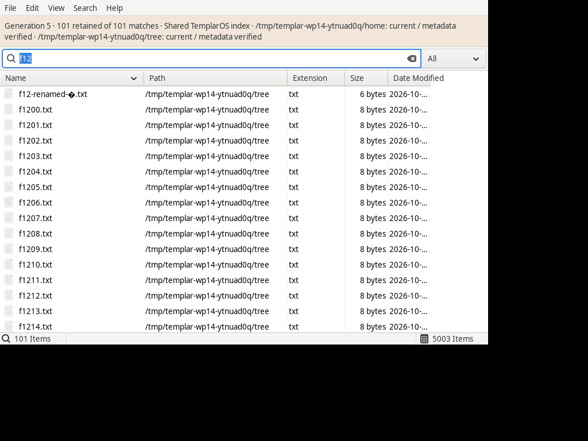

# FSearch using the shared index — 2026-10-08

Work: `@legeos.work.index-wp14-fsearch-20261008/2`. This records the native
dirty continuation tree at LegeOS `12295f351ab14e649f900573190060cd88a7251e`.
WP14 remains active: the nested shell/FSearch generation comparison is open.

## Source and actual package

The source is GPL-2.0-or-later FSearch at exact upstream commit
`05ed650ab101ee3d61795fa5eeeb5c32e1e366c3`, with the complete downstream quilt
patch in `distro/forks/fsearch/debian/patches/shared-templaros-index.patch`.
No published downstream Git branch is claimed. The ignored development checkout
is separate from the clean pinned checkout used by the package builder.

`scripts/build-fork-deb.sh fsearch --source .agent/scratch/index-wp14/source-clean`
built the actual `templaros-fsearch_0.3+templaros1-1~g05ed650_amd64.deb`.
Real Ubuntu 26.04 development packages were configured in an owned native PRoot
directory; dpkg's normal Build-Depends check passed. No host package was installed.
The retained helper uses `PROOT_NO_SECCOMP=1`, genuine GNU tools, a local PRoot 5.5
`openat2` path translation patch for zero resolution masks, and tar's
`--absolute-names` within owned staging. These accommodations are not in the
application or package. Source, helper patch, build logs and inputs are retained
under `.agent/scratch/index-wp14`.

| Artifact | SHA256 |
| --- | --- |
| DEB | `825c1eb947e699c13265ff50d85f947ca70926a066ba0605639116cb4234c0c2` |
| Quilt patch | `a0828ecb20fd19a05324f04aef5a4d2e848cff1277b9c53d15755c38c9a8a42d` |
| Extracted executable | `32f3f84b476cdcf8f869dedfac5f465777b3745e0f0a7e0b9edaf784316f210a` |

The index-mode compile graph excludes local database storage, scanner, index
store, rescan scheduler and folder monitors. The actual packaged executable has
no inotify, fanotify or SQLite-open imports. The package supplies the
`org.templaros.FSearch` desktop ID, keeps the executable `fsearch`, depends on
filed and Settings, and replaces the upstream distribution package. Its help
page describes the supported shared-index queries.

## Owned integration results

The current Meson translation suite passed its six cases. The integration scripts
in `distro/forks/fsearch/tests` created their own bus without activation
directories, daemon, HOME/XDG paths, Xvfb and 5,001-file fixture, including an
invalid UTF-8 filename. Both scripts exited zero; all owned children were reaped.

- The backend probe loaded the Roots count and exercised all 5,001 retained
  rows, the final page, Select All, native-byte actions, sorted selection,
  selection after external rename, generation refresh, bounded AND and explicit
  unsupported-query notices.
- The **actual packaged GTK window** displayed 101 results for `f12`, generation
  5, current roots and verified metadata, with 5,003 indexed entries in the status
  bar (the two root rows are included). Secondary `--search f13` and `f12`
  activations returned success and issued searches from the original application's
  unique bus caller.
- The application held zero inotify/fanotify FDs, created no `fsearch.db`, and
  performed no fixture-tree enumeration. The trace's exact GTK/runtime directory
  allowlist is retained in the JSON report and fork README. The fixture used
  GTK's simple input method; a desktop IBus daemon can independently watch its
  configuration.
- Controlled Index1 faults exercised Busy retry after at least 45 ms and
  exhaustion, Search/page SnapshotRequired recovery, Unavailable and recovery,
  typed cancellation and cancellation before admission. A failed Select All page
  cleared partial selection before exposing native actions.

The screenshot caught a defect the model probe had missed: an empty Search
returns zero by contract, so it cannot supply global database totals. The facade
now uses combined Roots entry counts without inventing a per-kind split, updates
application counts on generation changes, and checks that the GUI displays its
results panel. Screenshot capture runs in a separate process before Xvfb teardown.

## Limits and remaining acceptance

The facade is shared-index-only. Its bounded AND notice explicitly describes
filtering within retained rows. Unsupported query modes are reported; native
paths are validated and actions retain their bytes. Preferences use the existing
`templar-settings --page index` route; the plan's older `templar settings files`
command does not exist.

The actual nested same-query shell/FSearch generation screenshot is still open.
Provider defaults belong to WP16. Installed laptop/volume journeys and physical
HDMI qualification belong to the owner-run WP17 gates. These private results do
not establish those outcomes.

Machine-readable results: [JSON](index-fsearch-2026-10-08-wp14.json).
