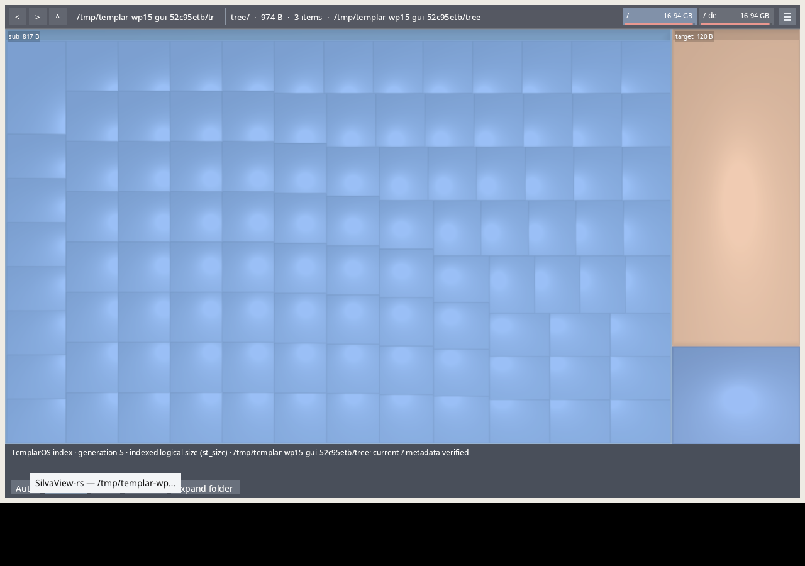

# WP15 — Silvaview shared index, native and nested observations

Observed 2026-10-08 on native Lubuntu/Ubuntu 26.04. LegeOS working tree is based
on `12295f351ab14e649f900573190060cd88a7251e`. The owning Silvaview repository
contains implementation commit `aeeae4a5795b11dc1a69564245a46c8a274c3cd5` and
fixture refinement `413ea0422b37aaf849d501c60ff2d1350d67aab6`. Its pre-existing
`debug-release`/`release-final` Cargo profiles and screenshot remain uncommitted.
The local Vello dependency was already present in HEAD. Source and binary hashes
are in [the JSON report](index-silvaview-2026-10-08-wp15.json).

## Native source and tests

The optional Linux `templaros` feature links the store-free index reader, minimal
zbus proxies and rustix. The normal dependency graph contains no rusqlite or
SQLite library. Feature-off builds preserve direct scanning. Native capped tests
passed **44 with the feature** and **30 without**, with zero failures. The real
GUI and private worker probe built successfully.

Service mode never starts a filesystem walk. Auto falls back only for no service,
incompatible service or uncovered paths; a failed established service stays an
error. Summary depth four and materialized subtree expansion use sealed, bounded,
CRC/identity/scope-validated mmap frames and borrowed entries. Native filenames
remain byte-preserving through final tree actions. One-second generation debounce
is event-driven. Load epochs carry the tree with the reply, avoiding the old shared
completion slot race. Linux text loading now supports a Noto-only installation.

## Owned private parity

`scripts/test-templaros-index.sh` in Silvaview passed using an owned bus with no
activation directories, fixture HOME/XDG paths and filed process. The fixture
has 5,000 regular files, 100 opaque `target` files, a non-UTF8 filename, hidden file,
hard link and child symlink. Policy is explicit: real directory root on one
filesystem, no nested mounts or excluded fixture bytes, hidden included, hard
links counted per path, child symlinks not followed but counted at their own
`st_size`, opaque cached recursive bytes included once.

| Observation | Result |
| --- | --- |
| Direct scan and materialized service total | Both 41,251 bytes |
| Summary | 1,200 known bytes, explicitly partial |
| Added 37-byte file | Generation 4 → 5; total 41,288 bytes |
| Native `FF` filename | Retained in the service tree |
| Service consumer watch FDs | 0 |
| Service consumer `getdents64` calls | 0 |
| Absent service, Auto / Service | Explicit fallback / visible error |
| Uncovered folder, Auto / Service | Fallback with Add-folder offer / visible error |
| Compatible owner returning Unavailable, Auto | Visible error; 0 directory reads |

## Actual nested GUI

`scripts/test-templaros-nested.sh` passed with the actual GUI on a private nested
Wayland compositor and shell, hosted by owned Xvfb. The compositor uses llvmpipe;
the client explicitly selects Mesa's lavapipe Vulkan ICD. No installed service
or desktop was changed. The nested launcher's new per-run directory and marker
keep cleanup confined to this lane's processes. Runtime sockets stay in the short
temporary fixture directory to avoid Unix path limits.

The private compositor input socket drove **Expand folder**. The visible summary
reported generation 4 and 120 known bytes with partial freshness; expansion showed
937 bytes, complete and metadata verified. Creating another 37-byte file produced
generation 5 and **974 bytes** automatically. Screenshots and application logs
retain all three states. The GUI held zero watch FDs and never enumerated the
fixture tree. Its other directory reads were `/dev/disk/by-id` for the existing
drive picker and four system Vulkan layer directories, listed exactly in JSON.
Nested application identity remained **unverified**, as expected for direct fixture
launches; this does not qualify launch authority.

## Limits

Ordinary Detailed directories currently lack cached recursive aggregates, so
summary totals can be a lower bound. The UI states that they are partial and
offers expansion. Opaque totals stay coarse and are not invented leaf rows.
The optional G7 name-pool/CSR optimization was not adopted without its required
million-entry measurement. This qualifies the binary, not a Silvaview package,
installed developer day, physical HDMI or GPU failover.

Full commands, tests, traces, logs, screenshots and source cohort are kept under
`.agent/scratch/index-wp15` via `akr scratch keep`.
