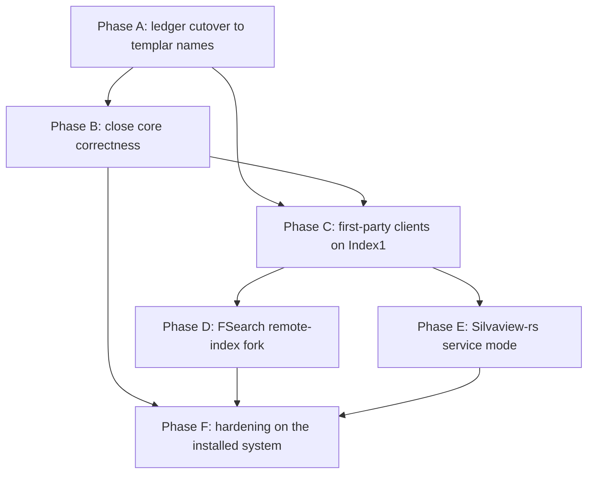

# Integrated indexing — what remains and how to finish it

**Status:** plan, derived from the AKR ledger
**Date:** 2026-10-01
**Plan of record it completes:** [`shared-incremental-file-index.md`](shared-incremental-file-index.md)
(design, contract, acceptance gates). This document does not restate that design. It records how
far the work has got and orders what is left.

Ledger records this plan draws on (`akr get <key>`):

| Record | State | Role |
| --- | --- | --- |
| `legeos.work.shared-incremental-file-index` | completed | Core, maintenance, freshness, one owner, warm start, 2M scale |
| `legeos.work.file-index-core` (F1), `legeos.work.file-index-maintenance` (F2) | completed | Phases 0–2 of the plan of record |
| `legeos.work.adaptive-index-maintenance` | completed | Coverage tiers, split freshness, idle watcher, backend choice |
| `legeos.work.memory-polling-indexing-effectiveness-20260909` | active | Astra fix set; 7 of 9 children done (the other 2 are the deferred records below), parent checks unrun |
| `legeos.work.btrfs-delta-baseline-checkpoint-protocol-20260909` | proposed (deferred) | Delta backend baseline lineage |
| `legeos.work.index-children-parent-id-contract-20260909` | proposed (deferred) | `Index::children` by indexed parent |
| `legeos.work.silvaview-and-fsearch-share-the-index` | proposed | The two external consumers; the only open plan-of-record gate |
| `legeos.decision.inotify-remains-the-index-event-backend` | proposed, at-risk | Event backend |
| `legeos.decision.btrfs-delta-is-an-opt-in-catch-up-backend-not-the-default` | active | Downtime catch-up on btrfs |
| `legeos.observation.home-tree-exceeds-the-inotify-watch-budget/2` | stale | Premise of the inotify decision |
| `legeos.observation.lege-client-links-rusqlite-through-the-shared-index-types` | stale | Consumer types still link the store |

## Source handoff — 2026-10-05

The observations and ledger-state table below describe the 2026-10-01 assessment, not a new
runtime verification. Reopened index heads require provenance/evidence revalidation; they do
not by themselves establish a regression. The following source changes are implemented but
have not been built or exercised by the delegated index worker:

- Doctor opens the existing derived database **read-only**, without creating/migrating the
  index or opening authoritative session state. Schema 3 through the current supported schema
  are inspected without migration; unsupported schemas fail untouched. The bounded live read
  found schema 5, generation 13,510, an incomplete watcher-exhausted home root, refused watches,
  previous overflows and an ENOENT watcher error for a disappearing rustc output directory.
  A vanished child is now distinct from watch refusal/exhaustion; genuine exhaustion, overflow,
  budgets and stale root truth remain visible rather than being downgraded.
- Indexed immediate children use `(root_id,parent_id,path_bytes)` and streaming repair
  consumption, not a descendant-range decode. Migration 6 repairs legacy links; take-on-trust
  reconciliation and moves preserve parent identity. Default repair entry/byte budgets are
  unlimited unless explicitly configured, and an explicit budget remains an incomplete pass.
  Atomic delta acquisition cannot commit just a prefix above the watcher chunk limit.
- Production full-root reconciliation acquires **pre/post** Btrfs checkpoints. A bounded,
  recognized incremental stream must prove no overlapping change during that pass before the
  post-checkpoint can become a baseline. Raw commands are checked too, so a transient
  create/delete is not hidden by an empty net plan. Incompatible or busy acquisition keeps the
  ordinary watcher/reconcile path. Baseline identity includes disposable-cache UUID (migration
  7), root, generation, policy and subvolume. Durable pending fences prevent replay after a
  crash between commit and pointer publication; recursive watch coverage precedes Current.
- Store-free client models, native typed search sessions and snapshot consumption retain
  generation, total/truncation, namespace and metadata truth. `Index1.Observe(bool,u64)` pins an
  independent caller-owned token without renewal polling; disconnect releases all tokens.
  Closing an old cursor cannot detach a replacement or a reacquired observation after restart.
  Acquire/search cancellation drops an eventual owned result after the reply, and cleanup uses
  the acquired runtime even when Drop runs on the GUI thread. Unique-name loss revokes pending
  acquisition flags before commands are drained; no disconnected-name tombstone history or
  renewal timer is needed. The loss subscription is installed before the public name is claimed;
  subscription failure/end is an honest service failure instead of immortal lifetime pins.
  Newer row facts cannot be mislabeled with an older pinned page generation: they return
  `SnapshotRequired`; unchanged paging and deletion-as-absent retain their contracts.
  Snapshot wire flag constants are outside the store-only writer module; this fixes the missing
  aggregate-flag names reported by the parent's first store-free compile attempt. `OpenSnapshot`
  streams into a memfd and applies kernel WRITE/GROW/SHRINK/SEAL seals, then reopens an O_RDONLY
  descriptor before returning `sealed:true`; kernel creation/sealing failure is an actual
  publication failure, not an unsealed fallback. Private runtime coverage checks access mode,
  kernel seals, write, truncation and growth.
- Root policies use the existing `RootPolicy` through `RootPolicy`, `ConfigureRoot` and
  `RemoveRoot`. Native path bytes and policies live in authoritative `file_index_roots`, not
  only the disposable cache. Empty choices and removed HOME survive cache replacement/restart.
  Disabled monitoring preserves searchable rows but reports unwatched; it does not claim Current.
  Native path plus observed policy hash fences reads, updates and removals atomically in the
  authoritative store; `"absent"` is explicitly add-only. Cache UUID fences rebuild requests,
  and root IDs increase monotonically within a cache so removal/addition cannot recycle an
  old queued target. CLI `index policy/configure/remove` mirrors these Settings controls.
- `Actions1.RenderNative` and the client `render_native_path` helper preserve raw bytes through
  percent-encoded URIs and ANSI-C shell quoting. Plain UTF-8 text forms fail explicitly when
  unrepresentable. Treemap fallback is bounded and reports real depth/entry/read/missing-path
  limits; available-but-stale or broken indexed results do not silently trigger another scan.
- Bookmark export is explicit and additive with backup, owned-line evidence, native-entry
  preservation and atomic exchange conflict recovery. External file-manager mutations enter
  the watcher, never a fabricated filed undo journal.
  Ownership is recorded only after successful GTK publication; interrupted exports can leave
  an unmanaged line but cannot falsely adopt a native application's line. Editing/removing an
  owned native label drops its tracking without rewriting GTK when no additions are needed.

### Owner verification and remaining gates

Run once after source integration, not against the live desktop:

```sh
cargo test -p templar-file-index -p templar-filed -p templar-client -p templar-treemap -- --nocapture
```

`private_runtime` owns a private D-Bus socket, HOME/XDG stores and exact child PIDs. Its nonzero
exercise covers 258 warm paged/native hits, metadata update, rename, move, external trash without
invented undo, native URI/shell byte round trips, bookmark backup/preservation, bounded restart
visibility, GUI-thread cursor cleanup, observation reacquisition, kernel-sealed O_RDONLY snapshots
and persisted non-UTF8 root policy after cache deletion. Root-policy tests exercise stale
read/update/remove rejection and exactly one concurrent durable CAS winner.
It requires `dbus-daemon` and Bash; both session and optional system-bus calls are isolated.
`snapshot_consumer` consumes real writer frames, cached opaque totals, native paths, scope and
freshness. Focused core/service tests cover large atomic acquisition, parent identity, failed
publication/crash fences, transient/late acquisition changes, disposable cache identity and
last-check-to-rename bookmark conflicts. No success counts are claimed before the owner runs them.

Physical/mount evidence remains separate: real `@home` checkpoint privilege/lineage and reboot
recovery, the complete mounted home/project watch budget, overflow/convergence under real load,
2M broad-query latency/memory and installed first-party journeys. FSearch fork/packaging and
external Silvaview service mode still require their owned source/provenance lane; no substitute
private index or claimed external-consumer success is introduced here.

## 1. Where it stands

The service side is built: `templar-filed` is the only watcher and database owner, the core is
`crates/templar-file-index`, and `org.templaros.Files.Index1` serves `Roots`, `Search`,
`FetchPage`, `CloseCursor`, `OpenSnapshot`, `ChangesSince`, `Reconcile`, `GenerationAdvanced` and
`RootStateChanged`. `templar files index status|search|reconcile` exists, with `--json` and
`--print0`. `templar doctor` reports index size, generation, root states, watcher limits, last
event and last reconciliation (gate 10). The Home treemap reads `OpenSnapshot` through
`templar_client::tree_source::load_snapshot_tree` and falls back to `templar_treemap::scan` only
when no service answers.

What is not integrated yet is everything that *consumes* the index from outside that core:

| Plan-of-record gate (§6) | Status |
| --- | --- |
| 1 one owner · 2 no rescan on restart · 3 generation/freshness everywhere · 4 crash-safe generations · 5 2M entries · 6 lossless paths · 7 Search1 compatibility · 10 doctor | Met, with evidence in the ledger |
| 3 for first-party UI | Partly: the shell's Files search still calls `Files.Search1.Search` (`shell/templar-shell/src/surface/app.rs` `run_search`), so it gets lossy paths and no generation or freshness |
| Phase 3 Settings controls (roots, excludes, mount boundary, monitoring, rebuild) | Not started: nothing in `apps/templar-settings` or the shell touches index roots |
| 8 FSearch fork owns no watches or `fsearch.db` | Not started: no FSearch entry in `distro/forks/manifest.toml`; `fsearch` is not installed; the shell's "Search everywhere with FSearch" row targets stock FSearch, which keeps its own index |
| 9 Silvaview service mode | Not started: `/mnt/second/Rust-projects/Silvaview-rs/src` has no Index1, snapshot or `--index` code |

### 1.1 Observed on the installed system, 2026-10-01

- `/home` is btrfs (`@home` on `nvme0n1p6`). The btrfs delta work can now run on a real root
  instead of loopback images.
- `fs.inotify.max_user_watches` is 257,001, so the watch budget is 128,500. Counted through the
  index's own `RootPolicy` (`xtask index-bench dirs`), `/home/dk` holds 6,445 directories (0.05x the
  budget) and `/mnt/second` (the project drive) holds 110,258 (0.86x). Both roots together need
  about 0.91x. The old premise (189,089 home directories on Lubuntu) no longer holds; it is
  superseded by `legeos.observation.watch-budget-fits-home-and-project-drive-on-templaros`.
- Only one root is registered: `/home/dk`. The first `templar files index status` showed it
  `stale`, 1,132 entries, unwatched. The status call itself made a consumer arm the watcher. The
  journal then shows a reconcile committing generation 127 with 81,968 entries, after which it
  logged `no consumer wants the index observed; watches disarmed`. So the adaptive lifecycle works
  live, but with no consumer attached, the dormant periods are bridged only by reconciliation.
- The journal for this boot has no delta, baseline or checkpoint lines.
  `DeltaCatchUp::ensure_baseline` is still called only from tests
  (`services/templar-filed/src/delta_catchup.rs` lines 592 onward), so the btrfs fast path cannot
  seed itself on this machine. `btrfs_delta.rs:323` still uses an unbounded `read_to_end`.
- `Index::children` (`crates/templar-file-index/src/lib.rs:588`) still decodes the whole
  descendant range.
- When this plan was written, `akr check` failed under `--strict` because the lege→templar rename
  never reached the ledger: 517 scope paths matched nothing (AKR-G023), and acceptance commands
  such as `cargo test -p lege-file-index` named crates that no longer exist (AKR-G024). Phase A has
  since fixed this for the live index records.
- Search cost and correctness at the match limit are measured in §3
  (`legeos.observation.search-cost-is-linear-in-matches-and-truncation-is-not-best-first`).

## 2. Work plan



### Phase A — ledger cutover (done 2026-10-01, except one user decision)

- Revised to `templar-*` scope paths and acceptance commands:
  - `silvaview-and-fsearch-share-the-index`
  - `btrfs-delta-baseline-checkpoint-protocol-20260909`
  - `index-children-parent-id-contract-20260909`
  - `inotify-remains-the-index-event-backend`
  - `memory-polling-indexing-effectiveness-20260909/2`
  - `btrfs-delta-is-an-opt-in-catch-up-backend-not-the-default/2`

  None of them has index-scoped G022/G023/G024 diagnostics left. Completed and verified records
  keep their historical `lege-*` scopes.
- `home-tree-exceeds-the-inotify-watch-budget` is superseded by
  `watch-budget-fits-home-and-project-drive-on-templaros`, and the inotify decision now depends on
  the new observation.
- **Open, yours to decide:** move `inotify-remains-the-index-event-backend` from proposed to
  active. The new measurement strengthens it: home plus the project drive fit the budget with
  inotify alone.

### Phase B — close core correctness

These are already-scoped records. Order as the Astra parent prescribes.

1. **Close `memory-polling-indexing-effectiveness-20260909`.** Its seven non-deferred children are
   completed. Run its four parent checks (replay fidelity, scoped clippy, scoped tests, frozen
   signatures) with templar crate names, attach evidence, and complete it.
2. **`btrfs-delta-baseline-checkpoint-protocol-20260909`.** Unlike every earlier run, this one can
   be validated on a real `@home`:
   - Seed: production `begin_reconcile` / `complete_reconcile` acquire pre/post checkpoints
     around a complete root pass and refuse overlapping changes; owner mount evidence remains.
   - Atomic lineage: write the baseline pointer in the same commit as the applied generation, or
     after it with a recovery rule. Never write it before decode and apply succeed.
   - Re-arm recursive watches after a successful catch-up.
   - Bound the stream read in `btrfs_delta.rs` at the byte cap the host already reports.
   - Acceptance: the three `cargo test` checks in the record, plus the record's user-run fixture
     gate (`RUNBOOK-L3.md`), executed on this machine across a reboot. That is the evidence the
     btrfs decision says is still missing.
3. **`index-children-parent-id-contract-20260909`.**
   - Contract: every committed entry has a `parent_id`, and a query and its cursor materialise from
     one view.
   - Fix take-on-trust reconciliation, which leaves `parent None`, and `mutation::place_at`, which
     does not update `parent_id` on a move.
   - Measure reconcile cost before and after against
     `reconciliation-cost-tracks-tree-size-not-change-size`, then switch `children` to an indexed
     parent lookup.

Exit: both deferred records completed; the btrfs decision's "unmeasured on a real root" caveat is
closed by evidence.

### Phase C — first-party clients on Index1 (plan-of-record Phase 3)

1. **Shell Files search → Index1.** Replace `run_search`'s `Search1.Search` and `parse_hits` with
   `Index1.Search` and `FetchPage`:
   - typed hits with native-byte paths, so actions address the right file (gate 6 for the UI)
   - cursor paging and cancellation
   - `CloseCursor` on dismissal
   - a visible stale/offline marker from the response's generation and root states (gate 3 for the
     UI)

   Keep `Search1.SavedQueries` for the standard-path drawers until saved queries move into Index1.
   Do not widen Search1.
2. **A consumer that keeps the index observed.** With no attached consumer, the watcher disarms
   and freshness depends on reconciliation (§1.1). Decide whether the session shell holds a
   long-lived observer while a Files object or search panel is open. That is the behaviour
   `adaptive-index-maintenance` designed for. Make it explicit in the shell rather than incidental
   to whichever client last called `Roots`.
3. **Root policy in Settings.** Add the controls the plan of record names: add/remove roots
   (`/mnt/second`, removable volumes), excludes, the mount-boundary flag, monitoring on/off, and a
   rebuild button that calls `Reconcile`. Retire `Search1.IndexRoot` as a synchronous
   client-triggered walk, as the plan of record requires. Root registration becomes policy plus an
   asynchronous reconcile.
4. **Split consumer types from the store.** Feature-gate `rusqlite` out of `templar-file-index`'s
   `model`, `query` and `snapshot` modules, or move them to a store-free crate, and update
   `templar-client`, `cli/templar`, `templar-fanotify` and `xtask` manifests. This turns the stale
   `lege-client-links-rusqlite…` observation into a mechanical dependency check. It is also what
   lets Silvaview (Phase E) decode snapshots without linking SQLite.
5. **Search limit** (§3). Done on 2026-10-01: stage 1 and stage 2 are both built. What remains for
   this phase is deploying `templar-filed`, which you do yourself.

Exit (plan-of-record Phase 3): no first-party search surface walks roots or reads `Search1`
results for file hits, and `cargo tree -p templar-client -i rusqlite` fails.

### Phase D — FSearch remote-index fork (plan-of-record §4.2, Phase 4)

Precondition: met on 2026-10-01. With the search arrays, broad one- to three-character queries
at two million entries answer in p95 ≤ 18 ms (§3.4). The one exception is a needle containing
`/`, which still goes through SQL.

1. Add the fork to `distro/forks/manifest.toml`, pinned to upstream FSearch
   `05ed650ab101ee3d61795fa5eeeb5c32e1e366c3` or a newer reviewed commit. Ship it with GPL-2.0+
   provenance notices and a release review of the AGPL/GPL combination (ADR-0013). Use the identity
   `org.templaros.FSearch`.
2. Make the one design decision the plan of record left open: a compatibility `FsearchDatabase`
   facade backed by Index1 pages, or a rewrite of the window and result views. Recommended: the
   facade. It keeps upstream UI code and selection/sort contracts intact and shrinks the rebase
   surface.
3. Implement the remote provider: virtualised rows from `FetchPage`, sorting, selection, and
   open/launch actions over native paths. Then remove scanning, fanotify/inotify ownership,
   `fsearch.db`, update timers and `--update-database` from the TemplarOS build.
4. Translate the FSearch grammar subset into typed Index1 filters: name/path, quoted terms,
   negation, file/folder, size, modified time. Unsupported saved filters show as unsupported.
   Regex and wildcards wait for measured candidate limits.
5. Keep `--search <query>` for `ProviderRole::FileSearch` and activate an existing window instead
   of starting a second process. Switch `DEFAULT_FILE_SEARCH` in
   `crates/templar-session-core/src/providers.rs` and the shell's "Search everywhere" row only at
   parity.

Exit: Files search and the FSearch window report the same generation for the same query. Starting
FSearch creates zero watches (check `/proc/<pid>/fdinfo`), performs no recursive scan, and creates
no `fsearch.db`.

### Phase E — Silvaview-rs service mode (plan-of-record §4.3, Phase 5; sibling repository)

1. In Silvaview-rs, add `TreeSource` with a direct implementation (today's jwalk/MFT path) and a
   service implementation behind `cfg(target_os = "linux")`.
2. The service implementation calls `Files.Index1.OpenSnapshot` with the PATH|KIND|SIZE field mask
   and materialised detail. It decodes with the store-free snapshot types from Phase C.4 and feeds
   `tree::build_tree`. The conversion `templar_client::tree_source::raw_entries_from_snapshot`
   already performs is the reference.
3. Add `--index=auto|service|scan`:
   - `service` fails clearly instead of scanning.
   - `auto` falls back only when no compatible service exists.
   - An uncovered drive gets a user-mediated "add this root" that calls Index1, never a silent
     parallel scan.
4. Display source, root, generation and freshness. Rebuild the projection on a debounced
   `GenerationAdvanced`.
5. Declare the shared policy in a test: symlinks not followed, mount boundary, excludes,
   permission-limited subtrees, hard links. Under that policy, service and direct totals must
   match.

Exit: on TemplarOS a warm Silvaview launch performs zero recursive enumeration (verified with
`strace -f -e trace=getdents64`) and renders the same totals as `--index=scan` under the declared
policy. Together with Phase D this satisfies `silvaview-and-fsearch-share-the-index`
`#consumers-share-the-index`.

### Phase F — hardening on the installed system (plan-of-record Phase 6)

- Fuzz the snapshot decoder and Index1 JSON decoding.
- Crash-test every generation commit (kill during scan, apply and delta catch-up).
- Run long rename/event storms with a consumer attached and detached.
- Test cache deletion and rebuild, a removable volume going offline and returning, and a root on
  `/mnt/second` (NTFS through ntfs-3g FUSE, `fuseblk`, where monitoring support must be measured
  rather than assumed).
- All of this runs through `cargo test`, the headless renders and `scripts/nested-session.sh`.
  Nothing restarts the live `templar-filed`.

## 3. The match limit: raising it without paying for it

### 3.1 What limits matches today, and what it costs

There are two limits, and both drop the wrong rows:

- **Core `candidate_limit` = 50,000** (`crates/templar-file-index/src/lib.rs:93`).
  `Fts5TrigramPlanner` puts `LIMIT candidate_limit + 1` on the candidate SQL, *before* ranking
  (`query.rs:432/442`). Every candidate is then decoded as a full `EntryRow` (22 columns, two
  strings, two blobs), re-folded by `rank_of`, and sorted as whole rows. When the limit truncates,
  the cursor holds the first 50,000 rows in FTS/rowid order, not the best 50,000, so an exact
  match can be the row that was cut.
- **`Files.Search1` limit** (`services/templar-filed/src/search.rs:266`). The shell asks for 50
  hits scoped to the folder it shows. Search1 fetches the *global* top 200 (capped at 1,000) and
  filters by path prefix afterwards, so matches inside the folder that rank below 200 globally
  never appear.

Measured 2026-10-01 on a copy of the live index (94,953 entries; observation
`search-cost-is-linear-in-matches-and-truncation-is-not-best-first`):

| Query | Strategy | Matches | `candidate_limit` 50k | 200k |
| --- | --- | ---: | ---: | ---: |
| `e` | like-scan | 94,928 | 63 ms (truncated) | 126 ms |
| `rs` | like-scan | 14,468 | 34 ms | 34 ms |
| `cargo` | fts5-trigram | 14,691 | 19.5 ms | 18.9 ms |
| `main.rs` | fts5-trigram | 62 | 0.5 ms | 0.5 ms |

Cost is about 1.3 µs per matched row. For `cargo` it splits as follows:

| Step | Time |
| --- | ---: |
| FTS5 rowid lookup | 2.1 ms |
| ids after the filters | 5.8 ms |
| ids plus sort keys | 7.6 ms |
| full row decode | 10.9 ms |
| ranking and sorting whole rows in Rust | ~8.6 ms |

So the trigram lookup is not the bottleneck; materialising rows that will never be displayed is.
Folder-scoped Search1 for `lib` in the LegeOS checkout returned 21 of its 24 matches. Storage: FTS5
is 88 MiB of the 148.7 MiB vacuumed index (about 940 bytes per entry), because the trigram index
covers `path_display` and keeps its own copy of both columns.

### 3.2 Stage 1, as built: keys first, best K, exact total (SQL)

In `crates/templar-file-index/src/query.rs`:

- **The planner finds names only.** `QueryPlanner::plan` returns the SQL that selects matching
  `entry_id`s: FTS5 trigram for three characters or more, a `LIKE` over `name_fold` otherwise,
  and a `LIKE` over whole paths for a needle containing `/` (strategy `path-scan`).
- **Path-only matches come from matching directories.** These are the directories among the name
  matches, with nested ones dropped, joined back through their `[d/, d0)` byte ranges.
- **SQLite ranks, orders and cuts.** The rank is a `CASE` over `name_fold`, and the order is the
  same total order as before (`order_sql`). SQLite keeps the best `max_cursor_rows`, and only ids
  and ranks leave SQLite.
- **The total is always exact.** A count is run only when the cut is reached. `truncated` now
  means "the cursor holds the best K of `total`".
- **Full rows are read only for the page shown,** in one `json_each` statement (`materialize`),
  in search and in `fetch_page` alike.
- **`Query.within`** (serde-defaulted, no D-Bus signature change) scopes a search to directories
  in SQL. `Files.Search1` passes its folder through instead of filtering a global top 200
  afterwards.
- **`candidate_limit` is gone.**
- **FTS5 is names only and contentless** (`content=''`, `contentless_delete=1`).
  `schema::ensure_fts` replaces the old name+path table on open and refills it from `entries`,
  with no rescan.

### 3.3 Stage 2, as built: the search arrays

`crates/templar-file-index/src/arrays.rs` holds a cache of one committed generation's live rows,
as flat columns in path byte order:

- ids
- folded names in one blob
- each directory's subtree range
- kind, hidden/coverage flags, size, mtime
- sort permutations for mtime-desc, name and size

How a search uses them:

- **Matching** is a parallel scan of the names (up to 8 threads above 32k rows).
- **Path-only** matches are the union of the subtree ranges of directories whose name matches,
  swept once with a difference array. A directory's subtree is contiguous in byte order
  (`[d/, d0)`) but does not start right after `d`, because `d-x` and `d.rs` sort in between. The
  first build assumed it did, and comparing against SQL on real home data caught it (50
  mismatches).
- **Ordering** walks the permutation the sort needs, so there is no per-query sort. Ties break on
  position, which is path order.

How they are kept honest:

- **Used only when current.** The arrays must describe the current generation and root set, and
  `IndexConfig::search_arrays` must be on. The file service turns it on; the library default is
  off.
- **Rebuilt on demand.** A search that finds them stale answers through SQL and starts one
  background build (thread `templar-index-arrays`). Builds are at least
  `max(5 s, 2 × last build)` apart, so a tree that changes every second is not rebuilt every
  second. An index nobody searches costs nothing.
- **SQL still answers** a needle with `/`, and a `within` directory the arrays do not hold.
  `search_with(planner)` always uses SQL.
- **Tests.**
  - `the_search_arrays_answer_exactly_what_sql_answers` checks every sort, direction, filter and
    scope, including the cut. It covers names that sort between a directory and its children.
  - `stale_search_arrays_are_not_used`.
  - On a copy of the live index (99,447 rows), all 100 needle × sort × direction combinations
    matched SQL exactly.

### 3.4 Measured

`cargo run -q -p xtask --release -- index-bench workloads --allow-two-million`. The synthetic
fixture names its directories `d<n>` and its files `f<n>.txt`. Times are p50/p95, first page of
100 results.

| Needle (matches at 2M) | SQL stage 1 | Arrays |
| --- | ---: | ---: |
| `d` (1,999,968, nearly all path-only) | 3,257 / 3,264 ms | 16.8 / 17.8 ms |
| `f1` (550,000) | 1,169 / 1,171 ms | 14.9 / 18.0 ms |
| `txt` (1,600,000) | 1,728 / 1,737 ms | 16.8 / 18.2 ms |
| `f12.txt` (50,000) | 274 / 276 ms | 10.7 / 11.9 ms |
| `d3/d4` (118,673, path needle) | 688 / 689 ms | stays on SQL: 692 / 710 ms |

Building the arrays takes 1.6 s at 2,000,001 rows and 60–83 ms at 90–99k. On the real home index
copy (99,447 rows), SQL vs arrays:

| Needle | SQL | Arrays |
| --- | ---: | ---: |
| `e` | 234 ms | 2.4 ms |
| `cargo` | 28 ms | 1.7 ms |
| `main.rs` | 0.7 ms | 1.4 ms |

Selective needles cost about 1 ms more from the arrays, because of the fixed scan.

Known costs:

- **The SQL fallback got slower for one- and two-character needles.** `e` takes 234 ms where the
  old capped search took 126 ms, because it now counts and orders every match and expands
  directories. It only serves while the arrays are stale.
- **Memory.** The arrays add about 60 bytes per row plus the names: roughly 6 MB for this home,
  and on the order of 130 MB at 2M rows [INFERENCE from the column sizes].
- **Path needles.** A needle with `/` stays on SQL (690 ms at 2M). Matching it from the arrays
  would need path strings or a component-wise matcher; that is not built.
- **Database size.** At 2M rows the database measured 3.2 GB on disk, including WAL. That was not
  investigated here.

## 4. How the ledger closes

| Phase | Records completed or revised |
| --- | --- |
| A | Done: live index records revised to templar paths; home-tree observation superseded by `watch-budget-fits-home-and-project-drive-on-templaros`. Open: inotify decision proposed → active (user) |
| B | `memory-polling-indexing-effectiveness-20260909`, `btrfs-delta-baseline-checkpoint-protocol-20260909`, `index-children-parent-id-contract-20260909`; evidence added to the btrfs decision |
| C | New work records (propose): "Search limit stage 1 — keys-first, best-K, subtree scope in SQL" with the §3.2 tests and the 2M broad-query workload as acceptance; "First-party Files search, Settings roots and store-free consumer types on Index1", acceptance = Phase C exit; `lege-client-links-rusqlite…` observation superseded. Stage 2, if needed, is a decision citing the 2M measurement |
| D + E | `silvaview-and-fsearch-share-the-index` completed with one evidence record per consumer |
| F | New work record for hardening, acceptance = the Phase F scenarios as commands |

## 5. Risks

- **Watch budget on the full machine.** Home plus `/mnt/second` need about 0.91x of the 128,500
  watch budget (§1.1). That fits, but with little headroom: one more large root, or the old
  Lubuntu home migrated wholesale, exhausts it, and the roots then commit as
  `Stale{WatcherExhausted}`. Mitigation: coverage tiers (index build trees without watching them)
  and measured exclusion defaults before further roots are added.
- **NTFS project drive.** The btrfs delta does not apply there, and monitoring support differs.
  Expect reconcile-only freshness for that root and show it.
- **FSearch fork maintenance.** The facade is the smallest diff, but upstream's `FsearchDatabase`
  contract can shift. Pin and rebase deliberately.
- **Silvaview lives elsewhere.** Its acceptance cannot be verified from this repository. Evidence
  must cite the sibling repository's commit.
