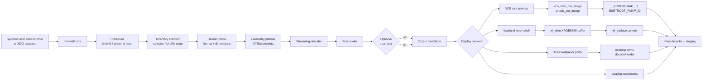
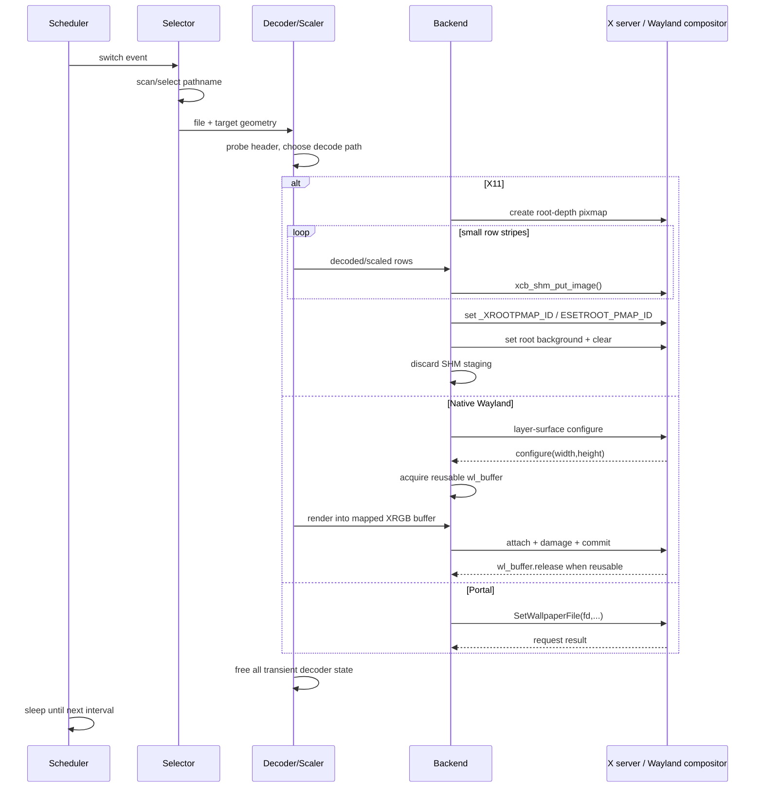

# Low-Memory Linux Background Switcher: Design and Evaluation

> Imported research, not an adopted implementation specification. Original JSON export SHA256: 7b931e593c4584a6ceea84bc74903f6666bb8e4422c1eaf7ec87dec593ee5af9. Extracted report SHA256 before citation normalization: 86f5746934ef9c6ea6c0d003e970268a59e02f4a97ba3b624ade44dcb48d8977. Metadata timestamp: 2026-09-11T03:02:36.827090Z. Export title is verified; chat title/direct conversation URL are not. backing_conversation_id: 6aa36e6a-16b0-83ec-a496-d8d4379c84da. Only citation markers have been converted to the URLs supplied by the export. Estimates remain estimates.

## Executive summary

A background switcher with a **routine resident memory footprint far below 55 MB is straightforward on X11**, but the same target is structurally harder on native Wayland because the wallpaper client normally has to remain alive and keep at least one compositor-visible pixel buffer. The most effective design is therefore **backend-specific rather than forcing one rendering model everywhere**.

The recommended implementation is a small, single-threaded C program with no GTK/Qt/Cairo dependency in its core. Use `libxcb` plus `libxcb-shm` on X11, `libwayland-client` plus the `wlr-layer-shell` protocol where supported, and the XDG Wallpaper portal as a compatibility backend for desktop environments that own wallpaper policy. Decode JPEG incrementally with libjpeg-turbo, PNG row-by-row with libpng, and WebP directly into caller-provided output buffers using libwebp. Do not cache decoded full-resolution images by default. Libjpeg-turbo explicitly supports scanline-at-a-time decompression, libpng exposes row reads, and libwebp supports externally supplied output buffers and decoder-side scaling. [[source 1](https://developers.google.com/speed/webp/docs/api); [source 2](https://raw.githubusercontent.com/libjpeg-turbo/libjpeg-turbo/main/src/example.c); [source 3](https://www.libpng.org/pub/png/libpng-manual.txt)]

For X11, the best implementation is **XCB root pixmap + small MIT-SHM upload stripes**. Create a server-side pixmap at root depth, decode/scale a limited number of rows at a time into a small shared-memory staging area, issue `xcb_shm_put_image()`, then set the root background pixmap and publish the conventional `_XROOTPMAP_ID`/`ESETROOT_PMAP_ID` properties. Xlib/XCB permits the pixmap to remain server-side after client image memory is freed; tools such as `feh` use exactly the root-pixmap/property/retain-resource pattern. [[source 1](https://github.com/derf/feh/blob/master/src/wallpaper.c); [source 2](https://www.x.org/releases/current/doc/libX11/libX11/libX11.html); [source 3](https://xcb.freedesktop.org/manual/group__XCB__Shm__API.html)]

One terminology correction is important: **`_XROOTPMAP_ID` is not an EWMH property**. It is a long-standing de facto root-pixmap convention, often paired with `ESETROOT_PMAP_ID`, whereas EWMH is a separate freedesktop.org specification for window-manager hints. `feh` implements these root-pixmap properties specifically for interoperability with programs that inspect the root wallpaper. [[source 1](https://github.com/derf/feh/blob/master/src/wallpaper.c); [source 2](https://specifications.freedesktop.org/wm-spec/latest/)]

For native Wayland, there is no universal “set root window” operation. A wlroots-style implementation creates a background-layer surface using `wlr-layer-shell` and supplies `wl_buffer` objects backed by `wl_shm`; the compositor may retain access to a committed buffer until it sends `wl_buffer.release`. Consequently, a single 3840×2160 XRGB8888 buffer alone occupies **31.64 MiB**, and two such buffers occupy **63.28 MiB before code, heap, decoder state, or libraries**. The Wayland core protocol requires support for ARGB8888/XRGB8888 shared-memory formats, making 32 bits/pixel the only universally safe baseline. [[source 1](https://wayland.freedesktop.org/docs/html/apa.html)]

That leads to these practical memory targets:

| Configuration | Pixel storage alone | Practical goal |
|---|---:|---:|
| X11, 1080p, stripe uploader | ~0.25–1 MiB client staging + server pixmap | **3–10 MiB idle PSS**, <15 MiB switching |
| X11, 4K, stripe uploader | ~0.5–2 MiB client staging + 31.64 MiB server pixmap | **3–10 MiB idle PSS**, <20 MiB switching |
| Wayland, 1080p XRGB | 7.91 MiB per retained buffer | **12–20 MiB** plausible |
| Wayland, 4K XRGB, one retained buffer | 31.64 MiB | **~35–45 MiB** plausible |
| Wayland, 4K, two full buffers | 63.28 MiB | **cannot meet a 55 MiB hard peak** |

These are engineering estimates derived from buffer dimensions, not measured claims about a particular allocator or compositor. They should therefore be validated as described in the benchmarking section.

A particularly strong optimization for X11 is to **avoid a permanent daemon altogether**: install a user `systemd.timer` that starts a `Type=oneshot` renderer every 5–60 minutes. The process has effectively zero resident RAM between wallpaper changes while the X server retains the root pixmap. Systemd explicitly supports repetitive timer activation with `OnUnitActiveSec=`/`OnUnitInactiveSec=`. [[source 1](https://raw.githubusercontent.com/systemd/systemd/main/man/systemd.timer.xml)] Native Wayland layer-shell cannot generally use this trick because destroying the client destroys its surfaces; there a persistent client or DE/portal delegation is required.

## Backend and desktop compatibility

The implementation should expose a uniform rendering abstraction but let each backend choose the least expensive native mechanism:

```text
backend_ops
    probe()
    enumerate_outputs()
    begin_frame(output, width, height, format)
    write_rows(y, n, pixels, stride)
    commit()
    release_transients()
    shutdown()
```

### X11 root-window backend

For traditional X11, obtain the root window and its visual/depth, create a root-sized server pixmap with `xcb_create_pixmap()` or `XCreatePixmap()`, upload pixels, and call the equivalent of `XSetWindowBackgroundPixmap()` followed by a clear/repaint. Xlib documents that `XSetWindowBackgroundPixmap()` changes the window's background pixmap but does not itself repaint existing contents, so the conventional sequence includes a clear. [[source 1](https://www.x.org/releases/current/doc/libX11/libX11/libX11.html)]

A compatibility implementation should additionally intern and set both:

```text
_XROOTPMAP_ID
ESETROOT_PMAP_ID
```

to the new pixmap. Before replacing an old wallpaper, inspect both properties; if both identify the same old pixmap, it is possible to clean up the previous retained resource using the conventional client-kill mechanism, then install the new resource. `feh` follows this pattern, updates the root-window background, clears the root window, flushes, and uses `RetainPermanent` before disconnecting. Xlib's close-down modes explicitly allow X resources to survive client termination. [[source 1](https://github.com/derf/feh/blob/master/src/wallpaper.c); [source 2](https://www.x.org/releases/current/doc/libX11/libX11/libX11.html)]

There are two upload variants:

```c
/* Lowest dependency count, but image bytes cross the X socket. */
xcb_put_image(c, XCB_IMAGE_FORMAT_Z_PIXMAP,
              pixmap, gc,
              width, rows,
              0, y, 0, depth,
              byte_count, stripe);

/* Preferred when MIT-SHM is present. */
xcb_shm_put_image(c, pixmap, gc,
                  width, stripe_height,
                  0, 0, width, rows,
                  0, y,
                  depth, XCB_IMAGE_FORMAT_Z_PIXMAP,
                  0, shmseg, 0);
```

XCB exposes both ordinary `xcb_put_image()` and MIT-SHM `xcb_shm_put_image()`; MIT-SHM exists specifically to place shared-memory image data into an X drawable without routing the pixel payload through the ordinary X transport. [[source 1](https://www.x.org/releases/current/doc/xextproto/shm.html); [source 2](https://xcb.freedesktop.org/manual/group__XCB__Shm__API.html); [source 3](https://xcb.freedesktop.org/manual/group__XCB____API.html)]

**Use XCB rather than Xlib for the main implementation.** It gives direct control over allocations and protocol requests and does not require maintaining an Xlib `XImage` object. Xlib can still be offered as a small compatibility backend; there is no fundamental memory advantage to Xlib here.

The root-pixmap approach works naturally with window managers where the X root remains the effective desktop surface. A full desktop shell may instead place its own desktop surface/window above the root or manage wallpaper itself; in those environments a DE/portal backend is more robust. Likewise, changing the XWayland root changes XWayland's X root, not the Wayland compositing desktop, so it is not a substitute for a native Wayland backend.

### Wayland layer-shell backend

A native wallpaper client for wlroots-style compositors should:

1. Connect with `wl_display_connect()`.
2. Bind `wl_compositor`, `wl_shm`, `wl_output`, and `zwlr_layer_shell_v1`.
3. Create one `wl_surface` per desired output.
4. Give each surface a `ZWLR_LAYER_SHELL_V1_LAYER_BACKGROUND` role.
5. Anchor to all four edges.
6. Set an exclusive zone of `-1` when the wallpaper is intended to extend under panels.
7. Wait for configure, allocate the correctly sized shared-memory buffer, render it, attach, damage, and commit.

The layer-shell protocol explicitly defines a **background** layer and requires configure/acknowledge negotiation before a correctly configured buffer is attached. [[source 1](https://wayland.app/protocols/wlr-layer-shell-unstable-v1)]

The framebuffer is normally created with an anonymous shared-memory file:

```c
int fd = memfd_create("miniwall-buffer", MFD_CLOEXEC);
ftruncate(fd, size);

void *pixels = mmap(NULL, size,
                    PROT_READ | PROT_WRITE,
                    MAP_SHARED, fd, 0);

struct wl_shm_pool *pool =
    wl_shm_create_pool(wl_shm, fd, size);

struct wl_buffer *buf =
    wl_shm_pool_create_buffer(pool, 0,
                              width, height,
                              width * 4,
                              WL_SHM_FORMAT_XRGB8888);
```

Wayland specifies that `wl_shm_pool` represents memory mapped between client and compositor, and buffers can be made from parts of that pool. The protocol also states that the client must not reuse the buffer while the compositor is still accessing it; `wl_buffer.release` signals that reuse is safe. [[source 1](https://wayland.freedesktop.org/docs/html/apa.html)]

This is also how established implementations are structured. `swaybg`, for example, creates a POSIX shared-memory object, `ftruncate()`s it, `mmap()`s it, creates a `wl_shm_pool` and `wl_buffer`, and uses a four-byte stride per pixel. It layers Cairo on top of that memory. [[source 1](https://github.com/swaywm/swaybg/blob/master/pool-buffer.c)]

For this project, **omit Cairo** and write directly into the shared memory.

### Portal and desktop-environment backend

The freedesktop XDG Wallpaper portal is not a Wayland wire protocol; it is a desktop D-Bus portal. Its `SetWallpaperURI` and `SetWallpaperFile` operations hand a wallpaper to the desktop environment, which then owns rendering and persistence. The API exposes options for previewing and choosing background/lockscreen/both, but it does **not** expose fit/fill/tile geometry or low-level output buffers. [[source 1](https://flatpak.github.io/xdg-desktop-portal/docs/doc-org.freedesktop.portal.Wallpaper.html)]

That makes the portal attractive when:

- the desktop itself insists on controlling wallpapers;
- broad GNOME/KDE-style integration matters more than renderer-level control;
- the `<55 MB` requirement refers to **the switcher's own process RSS/PSS**, because the switcher can avoid decoding entirely.

It is less suitable when the program must implement identical scaling semantics on every desktop.

### External `swaybg` mode

`swaybg` is a useful compatibility/reference backend on layer-shell compositors. Its documentation supports `stretch`, `fill`, `fit`, `center`, and `tile`, including per-output configuration. The project states that it works with Wayland compositors implementing layer-shell plus sufficiently new `wl_output` support. [[source 1](https://github.com/swaywm/swaybg); [source 2](https://github.com/swaywm/swaybg/blob/master/swaybg.1.scd)]

Its downside for this design is dependency and memory control: the implementation uses Wayland shared memory plus Cairo, and optional GdkPixbuf support broadens image-format handling. A dedicated switcher can avoid those libraries and combine its decoder directly with `wl_shm`. [[source 1](https://github.com/swaywm/swaybg); [source 2](https://github.com/swaywm/swaybg/blob/master/pool-buffer.c)]

A reasonable backend preference order is therefore:

```text
auto:
    if WAYLAND_DISPLAY:
        if requested/available: portal
        else if zwlr_layer_shell_v1 advertised: native-wayland
        else if swaybg found: swaybg
        else error
    else if DISPLAY:
        xcb-shm if MIT-SHM exists
        else xcb-put-image
```

## Architecture and control flow

The core should be intentionally small: one process, one thread, one event loop, no plugin framework that forces heavyweight runtimes, no decoded-image cache by default, and no periodic directory watcher unless explicitly requested.



The corresponding update sequence is:



### Scheduler and state

For a persistent daemon, use a Linux `timerfd` in the same `poll()`/`epoll()` loop as the XCB/Wayland connection. A five-minute interval is `300 s`; one hour is `3600 s`. There is no reason to wake every second to check a clock.

The persistent state can stay well below one megabyte:

```c
struct app_state {
    enum backend backend;
    enum scale_mode mode;

    uint32_t interval_sec;     /* 300..3600 */
    uint64_t prng_state[2];

    char *directory;
    char *current_path;

    /* Small protocol objects only; no full decoded cache. */
    struct x11_state *x11;
    struct wayland_state *wayland;

    /* Optional <= few-hundred-KiB file index. */
    struct image_index *index;
};
```

For `random=true`, a directory can be sampled with reservoir sampling so all candidate filenames need not be held simultaneously. For exact shuffle-without-repetition, a compact pathname/index table is reasonable; even 10,000 names averaging 80 bytes are only about 0.8 MB before indexing overhead. If a pathological million-file directory must remain low-memory, store the index on disk and `mmap()` it rather than retaining a large heap vector.

### Scaling semantics

Implement the geometry planner independently from image decoding:

| Mode | Scale | Placement |
|---|---|---|
| `stretch` | independently to `screen_w × screen_h` | fills screen; changes aspect ratio |
| `fit` | `s = min(screen_w/image_w, screen_h/image_h)` | centered with bars |
| `fill` | `s = max(...)` | center-crop excess |
| `center` | no upscaling; 1:1 unless optional downscale policy is enabled | centered |
| `actual` | strict 1:1 | configurable origin; default `(0,0)` |
| `tile` | no scale unless separately requested | repeat source horizontally/vertically |

A simple bilinear scaler needs only a small number of source rows plus one output row. For low-memory shrinking, a separable box/area filter is also practical: accumulate source-row contribution into a destination-row accumulator and emit rows once their source range is complete. There is no need for a full intermediate resized bitmap.

## Implementation approaches and memory model

The table below uses a **single 3840×2160 display** and 32-bit XRGB output as the principal comparison point. A 4K XRGB buffer is exactly:

\[
3840 \times 2160 \times 4 = 33{,}177{,}600\ \text{bytes}
= 31.64\ \text{MiB}.
\]

The ranges are architectural estimates, not benchmark measurements. They intentionally separate **switcher process memory** from server/compositor-side or GPU memory.

| Approach | Estimated switcher memory at 4K | Advantages | Disadvantages |
|---|---:|---|---|
| **One-shot setroot/feh-like X11 setter** | ~0 resident between switches; typically a few MiB to tens of MiB transient depending decoder | Absolute minimum long-term RAM; server retains wallpaper; ideal with `systemd.timer` | X11 only; external general-purpose setters can decode whole images and bring larger dependency stacks; less control over peak memory |
| **Direct XCB pixmap + `xcb_put_image`** | ~3–10 MiB idle; ~4–15 MiB switch-time with row/stripe decoder | Very small dependency set; server pixmap is outside client RSS; portable X11 | Pixel data crosses normal X transport; large requests must be segmented |
| **Direct XCB pixmap + MIT-SHM stripes** | ~3–10 MiB idle; roughly +0.25–2 MiB staging | Best X11 design: small client buffer, reduced protocol-copy overhead, exact memory control | Requires MIT-SHM; X server still holds a full root pixmap; shared-memory accounting needs careful PSS/RSS interpretation |
| **Native Wayland layer-shell + `wl_shm`** | ~35–45 MiB steady with one 4K buffer; >65 MiB with two | No external process; full control of modes/per-output behavior; small codebase without Cairo | Persistent framebuffer dominates RAM; two-buffer peak violates 55 MiB at 4K; layer-shell is compositor-specific rather than universal Wayland |
| **Delegate: portal or `swaybg`** | Portal: potentially only a few MiB in switcher; `swaybg`: at least framebuffer + libraries | Best DE integration via portal; `swaybg` is mature and already supports common scaling modes | Memory is moved rather than eliminated; portal lacks scaling control; `swaybg` uses Cairo/shared-memory buffering and is less tunable |

X server resources deserve separate reporting. Xlib's pixmap documentation makes clear that pixmaps are server resources, and `RetainPermanent` permits resources to outlive the client. Thus an X11 process may have a 5 MiB PSS while the X server holds roughly 31.6 MiB of root-pixmap pixels for a 4K display. Calling that a “5 MiB wallpaper implementation” is legitimate as a **process-memory** statement, but misleading as a whole-system-memory statement. [[source 1](https://www.x.org/releases/current/doc/libX11/libX11/libX11.html)]

Wayland's accounting differs because a `wl_shm` buffer is `mmap()`ed into the wallpaper process. The kernel reports shared-memory pages in process mappings, and PSS apportions shared pages among mappings/processes rather than simply counting every shared page in full. For meaningful results, measure both RSS and PSS and report `Pss_Shmem`/`RssShmem` separately. Linux documents `smaps_rollup` and the PSS proportional-sharing semantics directly. [[source 1](https://raw.githubusercontent.com/torvalds/linux/master/Documentation/filesystems/proc.rst)]

### Buffer-size reference

| Resolution | RGB24 | XRGB/RGBA32 | RGB565 | Indexed 8-bit |
|---|---:|---:|---:|---:|
| 1920×1080 | 5.93 MiB | 7.91 MiB | 3.96 MiB | 1.98 MiB |
| 2560×1440 | 10.55 MiB | 14.06 MiB | 7.03 MiB | 3.52 MiB |
| 3840×2160 | 23.73 MiB | 31.64 MiB | 15.82 MiB | 7.91 MiB |
| 7680×2160 | 47.46 MiB | 63.28 MiB | 31.64 MiB | 15.82 MiB |

The last row illustrates why a naïve “one giant framebuffer for all monitors” becomes problematic. On X11 that root-sized allocation can at least live server-side; on native Wayland, per-output buffers are normally the cleaner model, but their total size still scales with the sum of output pixels.

### `mmap`, zero-copy, and hardware acceleration

`mmap()` is useful in two distinct places:

**Shared output buffers.** It is intrinsic to low-level Wayland `wl_shm`, and suitable for the X11 MIT-SHM staging ring. This is the highest-value use. Wayland's shared-memory protocol explicitly models buffers backed by a mapped pool. [[source 1](https://wayland.freedesktop.org/docs/html/apa.html)]

**Compressed input.** Mapping a JPEG/WebP file can simplify pointer-based decoders, but it does not magically reduce decoded-memory requirements. A large compressed file can also inflate virtual address space while only touched pages become resident. A 32–128 KiB ordinary input buffer is therefore equally reasonable and makes resource bounds more obvious.

“Zero-copy” should be used carefully. The program can eliminate an **application-side intermediate copy** by having a decoder write directly into the display buffer or a SHM stripe. That does not guarantee end-to-end zero-copy: an X server may still copy SHM contents into a pixmap, and a Wayland compositor may upload a SHM image into a GPU texture.

GPU/EGL/Vulkan rendering is not recommended as the default. Wallpaper changes every 5–60 minutes; creating graphics contexts, shader pipelines, driver state, and GPU buffers to save milliseconds of occasional CPU scaling works against the primary RAM-minimization goal. CPU SIMD inside libraries such as libjpeg-turbo gives a better complexity/memory tradeoff. Hardware/GPU paths can remain an optional future backend, especially `linux-dmabuf` for environments where moving framebuffer storage from process RSS to device memory is valuable, but such a path changes where memory is accounted rather than removing the pixels.

## Decoding, scaling, and quantization pipeline

### Format strategy

A practical low-memory build should support these formats natively:

| Format | Recommended decoder | Memory behavior |
|---|---|---|
| JPEG/JFIF | **libjpeg-turbo** | Excellent: scanline decode; decoder-side DCT scaling; SIMD |
| PNG | **libpng** | Good for non-interlaced images: row-at-a-time decode |
| WebP | **libwebp** | Excellent: external output buffer plus decoder scaling |
| BMP | tiny in-project parser | Simple row reads for common uncompressed BMP |
| PPM/PGM | tiny in-project parser | Trivial streaming |
| TGA/GIF/other legacy | optional `stb_image` fallback | Convenient but generally full-image allocation |

Libjpeg-turbo's documented decompression flow uses `jpeg_read_header()`, `jpeg_start_decompress()`, then repeatedly calls `jpeg_read_scanlines()`, with an example that deliberately allocates only one scanline. It also supports scaled decompression ratios through `scale_num`/`scale_denom`, which should be used before generic software scaling when the source is substantially larger than the screen. [[source 1](https://raw.githubusercontent.com/libjpeg-turbo/libjpeg-turbo/main/doc/libjpeg.txt); [source 2](https://raw.githubusercontent.com/libjpeg-turbo/libjpeg-turbo/main/src/example.c)]

Libpng exposes `png_read_row()`/`png_read_rows()`, so non-interlaced PNGs can be processed without storing the complete image. PNG transformations can expand palettes to RGB, turn transparency chunks into alpha, and reduce 16-bit samples to 8-bit before they enter the scaler. Adam7-interlaced PNG complicates strict one-pass row streaming because the image is delivered in multiple passes; implement a documented fallback for such images. [[source 1](https://www.libpng.org/pub/png/libpng-manual.txt)]

Libwebp is especially convenient because its advanced decode interface can scale during decode and write into caller-owned memory. That allows the final Wayland framebuffer—or an X11 staging destination for a no-scale path—to serve directly as output storage. [[source 1](https://developers.google.com/speed/webp/docs/api)]

`stb_image` is useful as an optional “broad compatibility” decoder because it handles JPEG, PNG, TGA, BMP, PSD, GIF, HDR, PIC, and PNM and includes SIMD paths, but its normal `stbi_load*()` interface returns a complete decoded image allocation. That makes it a poor default for extremely large wallpapers under a hard peak-memory constraint. [[source 1](https://github.com/nothings/stb/blob/master/stb_image.h)]

MozJPEG should **not** replace libjpeg-turbo for this application. MozJPEG's primary purpose is producing more compression-efficient JPEG output and it is built around the libjpeg/libjpeg-turbo API; wallpaper switching needs fast, low-memory decoding rather than sophisticated encoding. [[source 1](https://github.com/mozilla/mozjpeg)]

### Concrete low-memory pipeline

The key rule is:

> Never create `decoded_image[source_width * source_height * 4]` unless the selected codec absolutely forces a fallback.

Instead:

```c
int switch_wallpaper(const char *path,
                     struct output *out,
                     enum scale_mode mode)
{
    struct image_info info;
    if (probe_image(path, &info) < 0)
        return -1;

    struct transform t = plan_transform(
        info.width, info.height,
        out->width, out->height,
        mode);

    /*
     * X11: begin_frame may create a server pixmap and a small SHM stripe.
     * Wayland: begin_frame obtains/reuses a full wl_shm buffer.
     */
    struct frame f;
    if (backend_begin_frame(out, &f) < 0)
        return -1;

    struct decoder *dec = decoder_open(path, info.format);

    /*
     * JPEG: choose nearest efficient DCT-scale factor before start_decompress.
     * WebP: request decoder-side target scaling where appropriate.
     */
    decoder_set_coarse_scale(dec, t.decode_width, t.decode_height);

    /*
     * For bilinear scaling, two nearby source rows are sufficient.
     * Keep bounded scratch independent of source image height.
     */
    uint8_t *src0 = alloc_row(t.decoder_width, 4);
    uint8_t *src1 = alloc_row(t.decoder_width, 4);

    /*
     * X11 typically uses several destination rows as an upload stripe.
     * Wayland may make dst point directly into its mapped framebuffer.
     */
    struct stripe dst = backend_map_write_region(&f);

    struct scaler sc;
    scaler_init(&sc, &t, src0, src1);

    while (!decoder_eof(dec)) {
        struct decoded_row row;

        if (decoder_read_row(dec, &row) < 0)
            goto fail;

        scaler_push_source_row(&sc, row.data);

        while (scaler_has_output(&sc)) {
            uint32_t y;
            uint8_t *dst_row =
                backend_next_output_row(&f, &dst, &y);

            scaler_emit_row(&sc, dst_row);

            if (quantizer_enabled())
                quantize_or_reduce_row_in_place(dst_row, out->width);

            /*
             * X11 flushes when a stripe fills.
             * Wayland direct framebuffer needs no per-row protocol request.
             */
            if (backend_region_full(&f, &dst))
                backend_flush_region(&f, &dst);
        }
    }

    backend_flush_region(&f, &dst);
    decoder_close(dec);
    free(src1);
    free(src0);

    if (backend_commit(&f) < 0)
        goto backend_fail;

    backend_release_transients(&f);
    return 0;

fail:
    decoder_close(dec);
    free(src1);
    free(src0);
backend_fail:
    backend_abort_frame(&f);
    return -1;
}
```

For JPEG, the codec-specific core looks approximately like this:

```c
struct jpeg_decompress_struct cinfo;
struct jpeg_error_mgr jerr;

cinfo.err = jpeg_std_error(&jerr);
jpeg_create_decompress(&cinfo);

jpeg_stdio_src(&cinfo, fp);
jpeg_read_header(&cinfo, TRUE);

/* Example: select decoder-side reduction when useful. */
cinfo.scale_num = chosen_num;
cinfo.scale_denom = chosen_denom;

/*
 * Request a native output layout that minimizes conversion when supported
 * by the build/API; otherwise RGB and expand during scaling.
 */
cinfo.out_color_space = JCS_RGB;

jpeg_start_decompress(&cinfo);

JSAMPROW rowptr[1];
while (cinfo.output_scanline < cinfo.output_height) {
    rowptr[0] = source_row_buffer;
    jpeg_read_scanlines(&cinfo, rowptr, 1);
    scaler_push_source_row(...);
}

jpeg_finish_decompress(&cinfo);
jpeg_destroy_decompress(&cinfo);
```

The essential property—one/few scanline storage rather than one entire decompressed JPEG—is explicitly supported by libjpeg-turbo's decompression API. [[source 1](https://raw.githubusercontent.com/libjpeg-turbo/libjpeg-turbo/main/doc/libjpeg.txt); [source 2](https://raw.githubusercontent.com/libjpeg-turbo/libjpeg-turbo/main/src/example.c)]

For PNG:

```c
png_structp png = png_create_read_struct(
    PNG_LIBPNG_VER_STRING, NULL, NULL, NULL);
png_infop info = png_create_info_struct(png);

png_init_io(png, fp);
png_read_info(png, info);

if (png_get_color_type(png, info) == PNG_COLOR_TYPE_PALETTE)
    png_set_palette_to_rgb(png);

if (png_get_valid(png, info, PNG_INFO_tRNS))
    png_set_tRNS_to_alpha(png);

if (png_get_bit_depth(png, info) == 16)
    png_set_scale_16(png);  /* or png_set_strip_16 */

png_read_update_info(png, info);

for (uint32_t y = 0; y < src_h; ++y) {
    png_read_row(png, png_row, NULL);
    scaler_push_source_row(...);
}
```

Those transformations and row-oriented APIs are part of libpng's documented interface. [[source 1](https://www.libpng.org/pub/png/libpng-manual.txt)]

For WebP, prefer an externally supplied destination:

```c
WebPDecoderConfig cfg;
WebPInitDecoderConfig(&cfg);

/* Fill cfg.input from WebPGetFeatures(). */

cfg.options.use_scaling = 1;
cfg.options.scaled_width  = target_w;
cfg.options.scaled_height = target_h;

cfg.output.colorspace = MODE_BGRA;
cfg.output.is_external_memory = 1;
cfg.output.u.RGBA.rgba  = display_pixels;
cfg.output.u.RGBA.stride = display_stride;
cfg.output.u.RGBA.size   = display_size;

VP8StatusCode rc = WebPDecode(file_data, file_size, &cfg);
```

The WebP decoder documentation specifically supports scaled decode and caller-provided external output memory. [[source 1](https://developers.google.com/speed/webp/docs/api)]

### X11 stripe sizing

A useful default stripe is 64 rows:

\[
3840 \times 64 \times 4 = 983{,}040\ \text{bytes}
\approx 0.94\ \text{MiB}.
\]

Thus a 4K X11 update needs less than 1 MiB of SHM staging rather than a 31.64 MiB client-side full framebuffer. With 32-row stripes the allocation falls to about 0.47 MiB.

The decode/scaler scratch can remain below roughly another 100–200 KiB for ordinary widths. The dominant 4K allocation is then the **server pixmap**, not the client.

### Wayland single-buffer policy

The default Wayland policy should be:

```text
buffers_per_output = 1
allow_second_buffer = only_if_memory_budget_allows
```

When the compositor has issued `wl_buffer.release`, the existing mapped buffer can be reused. The Wayland specification explicitly permits reuse after release. [[source 1](https://wayland.freedesktop.org/docs/html/apa.html)]

The difficult case is a requested wallpaper change while the current buffer has **not** been released. There are three possible policies:

```text
low-memory:
    wait until release; never allocate second full buffer

balanced:
    allocate second buffer if projected PSS <= configured memory budget

low-latency:
    always double-buffer
```

For this project, `low-memory` should be the default. Wallpaper switching has minute-scale latency requirements, so waiting for safe reuse is preferable to adding 31.64 MiB merely to make the update appear a few milliseconds sooner.

### Optional quantizer

Quantization should be a **plug-in pipeline stage and disabled by default**.

The crucial observation is that palette quantization usually does **not** reduce the final framebuffer on modern Linux desktops. Wayland guarantees XRGB8888/ARGB8888 SHM support, so the universally portable Wayland buffer remains four bytes per pixel. Similarly, ordinary modern X screens use true-color visuals rather than indexed wallpaper buffers. [[source 1](https://wayland.freedesktop.org/docs/html/apa.html)]

Quantization helps mainly in three cases:

**Decoded-image cache.** A 4K 8-bit index map requires 7.91 MiB instead of 23.73 MiB RGB24 or 31.64 MiB XRGB32. A palette adds only a few hundred bytes.

**Explicit 16-bit output.** When the chosen X visual or Wayland compositor advertises a compatible RGB565 format, reducing to 16 bits/pixel cuts a 4K framebuffer to 15.82 MiB. This must be runtime-negotiated; XRGB8888 remains the portable Wayland default. [[source 1](https://wayland.freedesktop.org/docs/html/apa.html)]

**Legacy/embedded indexed visuals.** An 8-bit palette can materially reduce both storage and transfer on suitable displays, but this should not drive the mainstream design.

A low-memory custom quantizer can build its palette from a coarse histogram rather than retaining pixels:

```c
#define BITS 5
#define BINS (1u << (BITS * 3))   /* 32^3 = 32768 */

uint32_t hist[BINS];              /* 128 KiB */

for each sampled decoded pixel:
    r5 = r >> 3;
    g5 = g >> 3;
    b5 = b >> 3;
    hist[(r5 << 10) | (g5 << 5) | b5]++;

palette = median_cut(hist, requested_colors);

/*
 * 32 KiB if each 5:5:5 bin stores one palette index.
 * Avoid nearest-palette searches for every output pixel.
 */
uint8_t lookup[BINS];
build_lookup(palette, lookup);

for each output pixel:
    idx = lookup[((r >> 3) << 10) |
                 ((g >> 3) << 5) |
                  (b >> 3)];
    quantized[y * width + x] = idx;
```

A 256-color quantized cache therefore costs approximately:

```text
4K index plane       7.91 MiB
histogram             0.125 MiB
5:5:5 lookup table    0.031 MiB
palette             < 0.001 MiB
```

compared with 31.64 MiB for an XRGB cache.

If JPEG is the source, libjpeg-turbo itself contains a colormapped-output mode controlled by `quantize_colors` and `desired_number_of_colors`; its documentation distinguishes one-pass and two-pass quantization, with two-pass processing trading more work for better color selection. [[source 1](https://raw.githubusercontent.com/libjpeg-turbo/libjpeg-turbo/main/doc/libjpeg.txt)]

For wallpaper use, however, the recommended order is:

```text
decode
  ↓
scale/crop
  ↓
optional quantize/cache
  ↓
expand/cache-read to native framebuffer format
  ↓
display
```

**Quantize after scaling**, not before it. This avoids spending quantization CPU on pixels that will be discarded by a fill crop or downscale and gives the palette statistics for the image users actually see.

Dithering should be `off` by default; optional ordered dithering has tiny memory needs, whereas diffusion dithering requires at least an error row and makes tiled/parallelized row processing more complicated. At 5–60 minute intervals the CPU cost is rarely severe, but the visual degradation of 256-color photographic wallpaper is often more important than the saved cache memory.

## Startup, scheduling, and configuration

### Recommended daemon service

For native Wayland or a configuration that needs a continuously alive process, use a **foreground user service**. Do not double-fork. Systemd recommends `Type=exec` for long-running services because startup failures such as an unexecutable binary are tracked more accurately than with `Type=simple`, while traditional `Type=forking` is discouraged. [[source 1](https://raw.githubusercontent.com/systemd/systemd/main/man/systemd.service.xml)]

`~/.config/systemd/user/miniwall.service`:

```ini
[Unit]
Description=Low-memory wallpaper switcher
PartOf=graphical-session.target
After=graphical-session.target

[Service]
Type=exec
ExecStart=%h/.local/bin/miniwall \
    --config %h/.config/miniwall/config.toml
Restart=on-failure
RestartSec=3s

# Hardening that does not require filesystem isolation from the wallpaper dir.
NoNewPrivileges=yes
PrivateTmp=yes

# Optional diagnostic guardrails; tune for monitor resolution.
MemoryHigh=48M
# MemoryMax=55M

[Install]
WantedBy=default.target
```

Systemd defines `graphical-session.target` specifically as active while a graphical X or Wayland session is running and recommends `PartOf=graphical-session.target` for services that should stop with that session. Actual session targets determine which independently enabled services are pulled in, so `WantedBy=default.target` is the more portable enablement mechanism when desktop integration varies. [[source 1](https://raw.githubusercontent.com/systemd/systemd/main/man/systemd.special.xml)]

Installation:

```bash
systemctl --user daemon-reload
systemctl --user enable --now miniwall.service
```

Do not hard-code `DISPLAY=:0` or `WAYLAND_DISPLAY=wayland-0`. Use the graphical-session environment inherited/imported by the user's login session. If a desktop does not make display variables available to user services, an XDG autostart entry is the portable fallback.

### Lowest-memory X11 deployment

For X11, the better architecture is often **oneshot + user timer**, eliminating the resident daemon:

`~/.config/systemd/user/miniwall.service`

```ini
[Unit]
Description=Set next low-memory X11 wallpaper

[Service]
Type=oneshot
ExecStart=%h/.local/bin/miniwall --once \
    --config %h/.config/miniwall/config.toml
```

`~/.config/systemd/user/miniwall.timer`

```ini
[Unit]
Description=Periodic wallpaper switch

[Timer]
OnStartupSec=15s
OnUnitInactiveSec=15min
AccuracySec=30s
Unit=miniwall.service

[Install]
WantedBy=timers.target
```

Systemd timers can trigger matching service units repeatedly; `OnStartupSec=` is particularly relevant to user service managers, while `OnUnitActiveSec=` and `OnUnitInactiveSec=` define monotonic repeated intervals. Timer accuracy is deliberately coalescible, which is desirable for wallpaper changes because exact millisecond timing provides no benefit. [[source 1](https://raw.githubusercontent.com/systemd/systemd/main/man/systemd.timer.xml)]

Set the timer to any desired value from:

```text
5min
10min
15min
30min
45min
1h
```

A timer-triggered X11 program can install a retained root pixmap and exit, leveraging X's retained-resource semantics. [[source 1](https://github.com/derf/feh/blob/master/src/wallpaper.c); [source 2](https://www.x.org/releases/current/doc/libX11/libX11/libX11.html)]

### XDG autostart fallback

Where user-systemd graphical-session integration is unreliable, install:

`~/.config/autostart/miniwall.desktop`

```ini
[Desktop Entry]
Type=Application
Name=miniwall
Exec=/home/USER/.local/bin/miniwall --config /home/USER/.config/miniwall/config.toml
Terminal=false
X-GNOME-Autostart-enabled=true
```

The XDG Autostart specification defines per-user autostart entries under `~/.config/autostart` and system-wide entries under `/etc/xdg/autostart`; it also defines `OnlyShowIn`, `NotShowIn`, and `TryExec` for desktop-specific behavior. [[source 1](https://specifications.freedesktop.org/autostart-spec/latest/)] Systemd itself includes an XDG-autostart generator for desktop environments that opt into it. [[source 1](https://raw.githubusercontent.com/systemd/systemd/main/man/systemd.special.xml)]

Traditional `/etc/init.d`/SysV scripts are a poor primary mechanism because a wallpaper belongs to a **logged-in graphical session**, not system boot. On a non-systemd system, the analogous solution should run from the desktop/session startup mechanism under the user's UID rather than starting a root daemon before the X/Wayland session exists.

### CLI and configuration schema

A compact CLI:

```text
miniwall [OPTIONS]

  -d, --directory PATH
  -i, --interval DURATION       5m..1h
  -m, --mode MODE              stretch|fit|fill|center|actual|tile
  -b, --backend BACKEND        auto|x11|x11-shm|wayland|portal|swaybg
      --random
      --shuffle
      --no-repeat
      --background RRGGBB
      --filter FILTER           nearest|bilinear|area
      --quantize N              0|16..256
      --prefer-rgb565
      --max-memory SIZE
      --once
      --recursive
      --output NAME
      --config PATH
      --verbose
```

A TOML configuration with explicit memory policy:

```toml
directory = "/home/alice/Pictures/Wallpapers"
interval = "15m"

backend = "auto"
mode = "fill"

random = true
shuffle = false
no_repeat = true
recursive = false

background = "#000000"
filter = "bilinear"

formats = [
  "jpeg",
  "png",
  "webp",
  "bmp",
  "ppm"
]

[output]
target = "*"

[memory]
max_mib = 48
decoded_cache_mib = 0
x11_shm_rows = 64
wayland_max_buffers_per_output = 1
mmap_input = false

[quantization]
enabled = false
colors = 256
dither = "none"
prefer_rgb565 = false
cache_indexed = false
```

Validation should reject:

```text
interval < 300 seconds
interval > 3600 seconds
quantize colors outside supported range
unknown scaling mode
memory configuration incapable of holding mandatory Wayland framebuffer
```

On a 4K Wayland screen, for example, setting `max_mib=20` should fail early with a diagnostic rather than pretending a 31.64 MiB XRGB framebuffer can fit inside the budget.

## Measurement and validation

The memory objective should be expressed precisely:

> **Primary criterion:** switcher process PSS and peak PSS.  
> **Secondary criterion:** RSS.  
> **System criterion:** additionally measure X-server/compositor memory and, where possible, GPU allocation.

Linux `/proc/PID/smaps` reports RSS, PSS, private/shared pages, and related mapping data; `smaps_rollup` provides accumulated values more efficiently. The kernel documentation defines PSS as each resident shared page divided proportionally among the processes mapping it. This distinction matters enormously for `wl_shm` and XShm. [[source 1](https://raw.githubusercontent.com/torvalds/linux/master/Documentation/filesystems/proc.rst)]

`ps` RSS alone is useful as a quick check, but `/proc/PID/smaps_rollup` should be the reference measurement:

```bash
grep -E \
'^(Rss|Pss|Pss_Anon|Pss_File|Pss_Shmem|Private|Shared)' \
/proc/"$PID"/smaps_rollup
```

The kernel notes that simpler RSS accounting can be asynchronous, whereas walking `smaps` provides a more precise snapshot. [[source 1](https://raw.githubusercontent.com/torvalds/linux/master/Documentation/filesystems/proc.rst)]

A recommended benchmark matrix is:

| Dimension | Test values |
|---|---|
| Displays | 1920×1080, 2560×1440, 3840×2160, dual 4K |
| JPEG | baseline and progressive; native-size and 8K source |
| PNG | RGB, RGBA, palette, 16-bit, Adam7 interlaced |
| WebP | lossy and lossless; native-size and oversized |
| Scaling | stretch, fit, fill, center, tile |
| Backends | XCB, XCB+MIT-SHM, layer-shell, portal, swaybg |
| State | cold page cache, warm page cache |
| Scheduling | one-shot and persistent daemon |
| Repetition | at least 30–100 switches per test |

Record four memory points for each run:

```text
M0 = idle after startup
M1 = immediately before decode
M2 = maximum during decode/scale/upload
M3 = steady state after all transient buffers are freed
```

The key derived metrics are:

```text
idle overhead       = M3 - mandatory framebuffer contribution
switching headroom  = M2 - M3
leak slope          = PSS(after run N) - PSS(after run 1)
```

The process should return approximately to the same steady-state PSS after every switch. A monotonic increase after repeated images is a stronger defect signal than a single peak.

### Massif

Use Valgrind Massif for allocation attribution:

```bash
valgrind \
  --tool=massif \
  --massif-out-file=massif.out \
  ./miniwall --once --backend x11-shm ...

ms_print massif.out
```

For this particular program, also run:

```bash
valgrind \
  --tool=massif \
  --pages-as-heap=yes \
  --massif-out-file=massif-pages.out \
  ./miniwall ...
```

This second form is important because normal Massif tracks heap allocators but does not directly account for application `mmap()` calls; `--pages-as-heap=yes` changes Massif to page-level profiling and includes mappings. That is especially relevant to Wayland framebuffer and XShm allocations. [[source 1](https://valgrind.org/docs/manual/ms-manual.html)]

Do not interpret Massif as a substitute for `/proc/PID/smaps_rollup`; use it to answer **which allocation path caused the peak**, while smaps answers **what the kernel regards as resident/proportional memory**.

### CPU and wake-up benchmarking

Measure a single wallpaper transition with:

```bash
perf stat \
  -e task-clock,cycles,instructions,cache-misses,page-faults \
  ./miniwall --once ...
```

Linux `perf stat` is specifically designed to run a command while gathering performance-counter statistics and supports events such as cycles, instructions, cache behavior and page faults. [[source 1](https://raw.githubusercontent.com/torvalds/linux/master/tools/perf/Documentation/perf-stat.txt)]

For hot-path profiling:

```bash
perf record -g ./miniwall --once ...
perf report
```

Expected hotspots should be:

```text
JPEG/WebP/PNG decoder
software scaler
pixel-format conversion
quantizer, when enabled
xcb/wl buffer copy or compositor handoff
```

The scheduler should consume effectively no CPU while waiting. Over a one-hour interval, wake-up count is more informative than average percentage rounded to `0.0%`.

### Protocol/backend inspection

For X11 validation, inspect both protocol-visible properties and server resources:

```bash
xprop -root _XROOTPMAP_ID ESETROOT_PMAP_ID
xdpyinfo -ext MIT-SHM
xwininfo -root
```

Check that repeated switches do not accumulate orphaned pixmaps. This is particularly important because the retained-resource mechanism intentionally lets an X resource survive the setter process. `feh`'s cleanup logic for old `ESETROOT_PMAP_ID`/`_XROOTPMAP_ID` resources is a useful behavioral reference. [[source 1](https://github.com/derf/feh/blob/master/src/wallpaper.c)]

For Wayland, run with protocol tracing during development:

```bash
WAYLAND_DEBUG=1 ./miniwall --backend wayland ...
```

and verify the expected lifecycle:

```text
registry bind
→ wl_surface create
→ layer_surface configure
→ ack_configure
→ wl_buffer attach
→ damage
→ commit
→ wl_buffer.release
```

Most importantly, confirm with `smaps_rollup` that the program does not retain obsolete mappings after output resize, hot-plug, or wallpaper replacement.

### Acceptance thresholds

A sensible release gate is:

| Backend/test | Recommended requirement |
|---|---|
| X11 1080p idle | **PSS < 8 MiB** |
| X11 4K idle | **PSS < 10 MiB** |
| X11 4K switch peak, streaming | **PSS < 20 MiB** |
| X11 oneshot timer | **0 switcher RAM between executions** |
| Wayland 1080p | **PSS < 20 MiB** |
| Wayland single 4K output | **PSS < 45 MiB** |
| Wayland 4K hard ceiling | **<55 MiB**, with single-buffer policy |
| Repeated 100 switches | **no sustained PSS growth** |
| Idle CPU | effectively zero except display/event wakeups |
| Switch CPU | decode/scale finishes comfortably before next 5-minute interval |

The strongest overall implementation is therefore **not one universal mechanism** but a three-tier design: **XCB+MIT-SHM stripes and retained server pixmaps for X11; a single-buffer, direct-`wl_shm` layer-shell client for compatible Wayland compositors; and XDG Wallpaper portal delegation for desktop environments whose shells own wallpaper policy**. This architecture keeps X11 memory far below the 55 MB target, keeps one-screen 4K Wayland realistically below it, avoids heavyweight UI toolkits, and makes every large allocation explicit and measurable. [[source 1](https://flatpak.github.io/xdg-desktop-portal/docs/doc-org.freedesktop.portal.Wallpaper.html); [source 2](https://wayland.freedesktop.org/docs/html/apa.html); [source 3](https://xcb.freedesktop.org/manual/group__XCB__Shm__API.html)]